# Billing & Finance — As-Built Record

**What this is.** A record of what the Billing & Finance module of Regalis WorkSpace does today, written from the deployed code. It is not a specification and it does not describe intended behaviour. Where the code does something odd, this document says so.

**Date of reading:** 31 October 2026. **Branch:** `DHK/Billing` at `464c6e7`.

---

## 0. How to read this document

### 0.1 Where each fact comes from

Every rule, figure, status and default below carries a source tag:

| Tag | Meaning |
|---|---|
| **[FE file]** | The deployed frontend bundle, `frontend/assets/<file>`. Production serves these exact files (see 0.3). |
| **[DC Type.Method file:line]** | **Decompiled** from the compiled API DLLs (`api\Regalis.*.dll`) with ilspycmd 11.2. File paths are relative to the decompiled project. **Line numbers are lines of the decompiled file, not of the original C# source**, which was not available. Anything tagged [DC] came from decompiled code, not source. |
| **[DB-P table.column]** | Production database schema or configuration, read from the production backup `RegalisWorkSpace_PROD_20261025_0200.bak` (25 Oct 2026, 02:00) restored to a throwaway database. Schema and settings only. |
| **[DB-D …]** | The Dev database `RegalisWorkSpace_Dev` on `localhost\SQLEXPRESS2025`. Used only where it differs from production, or for things production does not yet have. |
| **[API METHOD path]** | The swagger contract generated by the same API build (`/swagger/v1/swagger.json`, 321 paths). |
| **[LIVE]** | Seen happening in a browser or in the API log while running the deployed build locally (see Appendix A). |
| **NOT CONFIRMED** | I tried to confirm this and failed. Each one says what I tried. |

### 0.2 What "live" means here, and the limits of this reading

Production is the site `myregalis.com`. That domain currently resolves to 127.0.0.1 in public DNS. The site is published through Tailscale Funnel at `https://amstagserver.discus-ordinal.ts.net` (`deploy/production/08-go-public-tailscale.ps1:5`). The production API listens only on `127.0.0.1:82` on the server (`deploy/production/README.md:8`).

This reading was done on the PC `santhosh`, not on the server. Consequences:

| Source you asked for | What happened |
|---|---|
| Backend source at `C:\Users\Administrator\Downloads\Regalis` | **Not on this PC.** There is no `Administrator` profile here. All backend facts are from decompiled DLLs and are tagged [DC]. |
| Production DLLs at `C:\inetpub\wwwroot\Regalis_Prod\api` | **Not on this PC.** There is no `C:\inetpub` here. See 12.1 for what this means for the source-drift question. |
| Swagger at `http://localhost:81/swagger/v1/swagger.json` | Nothing was listening on :81. I started the deployed API build (`api\` in this repo) on :81 and took swagger from it. Production's own swagger is switched off: `Swagger:EnableInProduction` defaults to false [DC Program.cs:278]. A logged-out request for it returns 401 [LIVE]. |
| Deployed frontend bundles | Downloaded from production read-only, logged out. **All 85 JavaScript chunks are byte-identical to `frontend/assets` in this repo**, ignoring line endings. Only `env.js` differs (see 0.3). |
| Live database schema | Production backup of 25 Oct restored to `RegalisBilling_SchemaScratch` and read for schema and settings only. That database has been dropped. |

### 0.3 The deployed build in one paragraph

- **Frontend:** production serves `index-DI5X4c9f.js` with `Last-Modified` 28 Oct 2026 06:49:59 GMT, and the billing chunks listed in section 2. These are identical to the repo.
- **Production `env.js`** (last modified 29 Oct 2026 07:12:53 GMT) contains:
  - `window.__REGALIS_ONLINE_PAY__ = false;`, with the comment "Production: no online payments – customers pay at the front desk."
  - an empty Google client id.

  The repo's UAT copy sets `__REGALIS_ONLINE_PAY__ = true`.
- **API:** the API build in this repo (`api\Regalis.*.dll`) last changed in commit `cf11e53` (28 Oct 2026 12:26 IST). `deploy/production/promote-uat-to-prod.cmd` copies `Regalis_Src\api` to production (line 73), then copies the frontend (line 86). It does the frontend copy only after the production API answers `/health` (line 79).
- **Inference:** the production frontend is dated 28 Oct, so the production API is most likely this same build. **NOT CONFIRMED.** The production DLLs could not be read, and logged-out requests return 401 for every `/api` path, including made-up ones (`FallbackPolicy` [DC Program.cs:180]), so endpoint existence could not be probed.

---

## 1. What the module is for

Billing & Finance is the staff-side money area of Regalis WorkSpace. It does seven things:
- lists the GST invoices the system raises for bookings, passes and approved quotations, and lets staff cancel them or mark them sent;
- lists customer payments and prints receipts;
- shows and adjusts customer prepaid wallets;
- produces priced quotations that customers approve online and that turn into invoices;
- records company expenses;
- raises purchase orders to suppliers and keeps the supplier list;
- keeps bank accounts with hand-entered statement lines that can be matched to payments and expenses.

It is not a ledger. There is no chart of accounts, no journal and no payables (section 11).

---

## 2. The pages

The sidebar group "Billing & Finance" is `MST_Menu` row 30 (route `/admin/billing`), under a parent "Finance" (row 70) [DB-P MST_Menu]. Two separate controls decide who can use a page:

- **Sidebar visibility** comes only from `MAP_RoleMenu` [DC MenuQueryService.cs:8-9].
- **The page itself** is guarded only by a permission check, `Ne{permission}` → `T0(code) = permissions.includes(code)`, else redirect to `/forbidden` [FE index-DI5X4c9f.js].

These two are independent. Several roles can open pages that their sidebar does not show (section 8.3).

`/admin/billing` redirects to `/admin/billing/invoices` [FE index-DI5X4c9f.js].

| # | Page | Route | Route permission | In sidebar for (`MAP_RoleMenu`) | Code |
|---|---|---|---|---|---|
| 1 | Invoices | `/admin/billing/invoices` | INVOICE.VIEW | Administrator, Finance | `AdminInvoicesPage`, [FE AdminFinancePages-IT1.js] |
| 2 | Payments | `/admin/billing/payments` | PAYMENT.VIEW | Administrator, Finance | `AdminPaymentsPage`, same file |
| 3 | Wallet (list) | `/admin/billing/wallet` | WALLET.VIEW | Administrator, Finance | `AdminWalletPage`, [FE AdminWalletPages-RGw1.js] |
| 3b | Wallet (one customer) | `/admin/billing/wallet/:customerId` | WALLET.VIEW | (opened from 3) | `AdminWalletDetailPage` |
| 4 | Quotations (list) | `/admin/billing/quotations` | QUOTATION.VIEW | Administrator, Operations Manager, Finance | [FE AdminQuotationPages-COWOrOkL.js] |
| 4b | New / edit quotation | `/quotations/new`, `/quotations/:id/edit` | QUOTATION.VIEW + QUOTATION.CREATE (edit also uses CREATE, not EDIT) | (opened from 4) | `AdminQuotationFormPage` |
| 4c | Quotation detail | `/quotations/:id` | QUOTATION.VIEW | (opened from 4) | `AdminQuotationDetailPage` |
| 5 | Expenses | `/admin/billing/expenses` | EXPENSE.VIEW | Administrator, Operations Manager, Finance | [FE AdminExpensesPage-EX2.js] |
| 6 | Purchase Orders (list, detail) | `/purchase-orders`, `/purchase-orders/:id` | PURCHASE.VIEW | Administrator, Operations Manager, Finance | [FE AdminPurchaseOrderPages-C1FTHC0p.js] |
| 6b | New / edit PO | `/purchase-orders/new`, `/:id/edit` | + PURCHASE.CREATE / + PURCHASE.EDIT | (opened from 6) | `AdminPurchaseOrderFormPage` |
| 7 | Suppliers | `/admin/billing/suppliers` | SUPPLIER.VIEW | Administrator, Operations Manager, Finance | [FE AdminSuppliersPage-CK5H7i4k.js] |
| 8 | Bank Accounts | `/admin/billing/bank-accounts` | BANK.VIEW | Administrator, Finance | [FE AdminBankPages-BZwouxUO.js] |
| 9 | Transactions (page title "Bank Statement") | `/admin/billing/transactions` | BANK.VIEW | Administrator, Finance | same file, `mode:"all"` |
| 10 | **Reconciliation, hidden** | `/admin/billing/reconciliation` | BANK.VIEW | **Nobody.** Menu row 62 is `IsDeleted=1` | same file, `mode:"reconcile"` |
| 11 | Cash Collections | `/admin/billing/cash-collections` | PAYMENT.CASH_COLLECT | see section 13 | [FE AdminCashPages-PL2.js] |
| 12 | Cash Register | `/admin/billing/cash-register` | PAYMENT.CASH_CLOSE | see section 13 | same file |

Pages 11 and 12 are documented separately in **section 13, "Built but not live"**. Everything in section 3 is in the production bundle and its permissions exist in the production database.

Old URLs redirect into the group [FE index-DI5X4c9f.js]:
- `/admin/finance`, `/admin/invoices`, `/admin/payments`, `/admin/wallet`, `/admin/quotations(/:id)`, `/admin/expenses`, `/admin/purchase-orders(/:id)` and `/admin/suppliers`;
- `/admin/bank/accounts`, `/admin/bank/transactions` and `/admin/bank/reconciliation`.

**Code that ships but is never shown:**
- `AdminFinanceDashboardPage-CZFoEED2.js` is declared as a lazy import (`D3`) but no route renders it. Its menu row 54, "Dashboard" → `/admin/finance`, is deleted, and `/admin/finance` now redirects to Invoices.
- A lazy `RGbillingPage` is declared and never used.
- `AdminBillingPage-Dk7pQm3x.js` and `AdminCashPages-PL1.js` are older versions that nothing imports.
- `AdminFinancePages-IT1.js` also contains an old wallet component that no route uses.

---

## 3. Screen by screen

All screenshots were taken from the deployed build running locally against a scrubbed copy of the Dev database (Appendix A). **Every name, email, phone, GSTIN, address and amount in them is made up or test data.** None of it is production data.

Lists are 20 rows per page with Previous/Next buttons, unless stated. The server caps any page at 100 rows [DC Shared PagedRequest.cs:12,39].

### 3.1 Invoices — `/admin/billing/invoices`

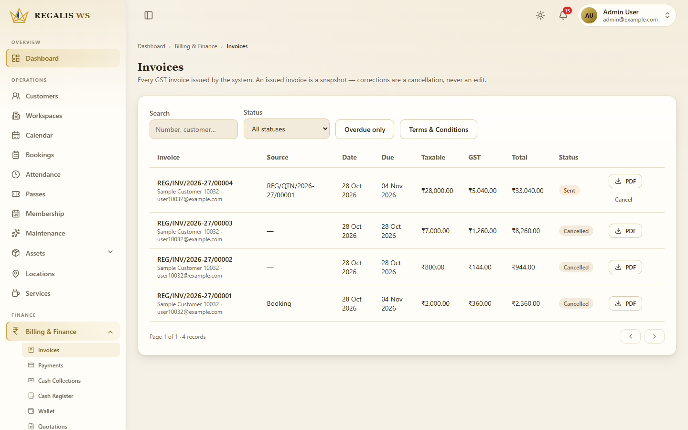

**Header.** "Invoices", with the subtitle "Every GST invoice issued by the system. An issued invoice is a snapshot — corrections are a cancellation, never an edit." Data comes from `GET /api/invoices`.

**Filters**
| Control | What it does |
|---|---|
| Search ("Number, customer…") | Debounced 350 ms. The server matches `InvoiceNumber`, `CustomerName` or `CustomerEmail` with *contains* [DC InvoiceService.GetInvoicesAsync InvoiceService.cs:78-82]. |
| Status | Pending, Paid, Partially paid, Cancelled, Refunded, Sent (values 1–6). Exact match (:57-60). |
| "Overdue only" toggle | Sends `overdue=true`, which uses the overdue rule in 4.4 (:65-69). |
| "Terms & Conditions" | Shown only with INVOICE.EDIT. Opens the terms dialog. |

The API also accepts `CustomerId`, `From` and `To` on invoice date [API GET /api/invoices], but the page has no control for them. `SortBy`/`SortDir` are accepted and ignored: the order is always newest `InvoiceId` first (:83).

**Columns**
| Column | Content |
|---|---|
| Invoice | Invoice number; customer name · customer email underneath |
| Source | The quotation number if the invoice came from one; otherwise "Booking" if it has a booking; otherwise "—". **Pass and membership invoices show "—"** because `InvoiceDto` has no pass id. |
| Date / Due | Invoice date; due date (red when overdue) |
| Taxable | `TaxableAmount` |
| GST | CGST + SGST + IGST |
| Total | `TotalAmount` |
| Status | Badge. Green only for Paid, grey for Cancelled, amber for everything else (Pending, Sent, Partially paid, Refunded). A red "Overdue" badge is added when overdue. |

**Row actions**
| Button | Shown when | Does |
|---|---|---|
| PDF | Always | `GET /api/invoices/{id}/pdf`, saved as the invoice number with "/" → "-". **The API needs INVOICE.PRINT, but the button does not check it**, so Support Executive and Housekeeping Staff get a 403 (section 8). |
| Mark sent | INVOICE.EDIT and status Pending | `POST /api/invoices/{id}/send`. **Only changes the status to Sent; nothing is emailed or sent anywhere** [DC InvoiceService.SendAsync :294-304]. |
| Cancel | INVOICE.EDIT, paid amount 0, not already Cancelled | Opens the cancel dialog |

There is no invoice detail view, no "create invoice", no "record payment", no edit, no credit note and no export on this page.

**Cancel dialog**

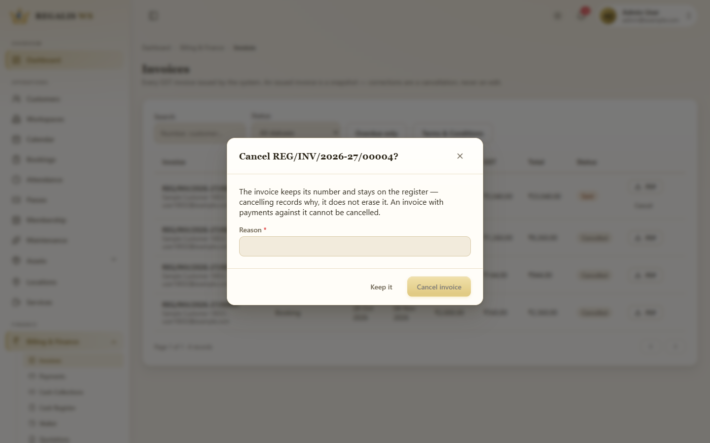

The dialog reads "The invoice keeps its number and stays on the register — cancelling records why, it does not erase it. An invoice with payments against it cannot be cancelled." Reason is required. "Cancel invoice" calls `POST /api/invoices/{id}/cancel {reason}`.

**Terms & Conditions dialog**

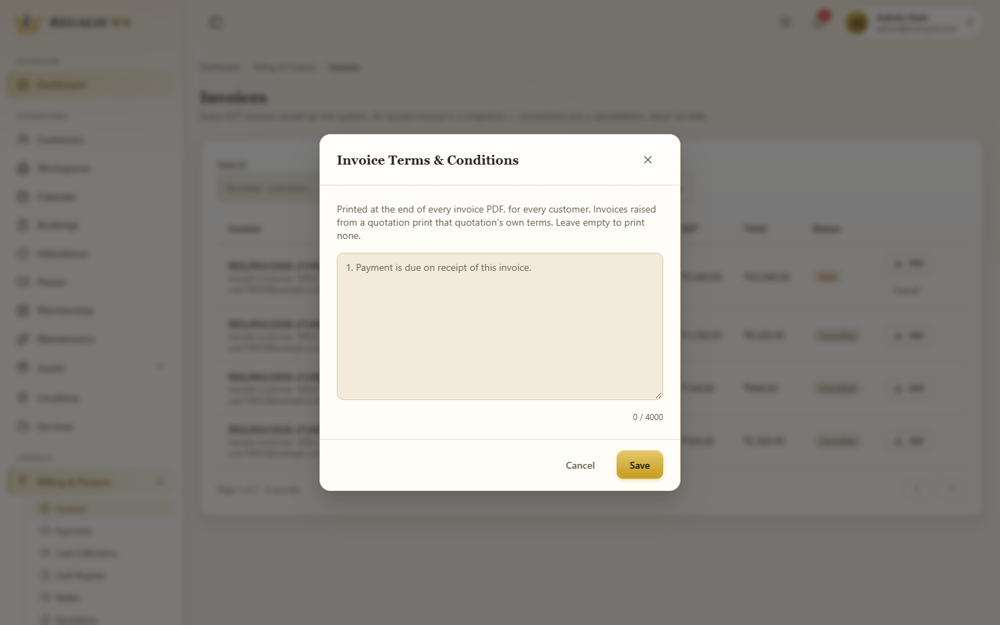

A textarea of up to 4,000 characters, with a counter. The note reads "Printed at the end of every invoice PDF, for every customer. Invoices raised from a quotation print that quotation's own terms. Leave empty to print none." It loads with `GET` and saves with `PUT /api/invoices/terms`, into setting `Invoice.TermsAndConditions` [DC InvoicesController :30-42]. In production this setting is empty [DB-P MST_AppSetting].

### 3.2 Payments — `/admin/billing/payments`

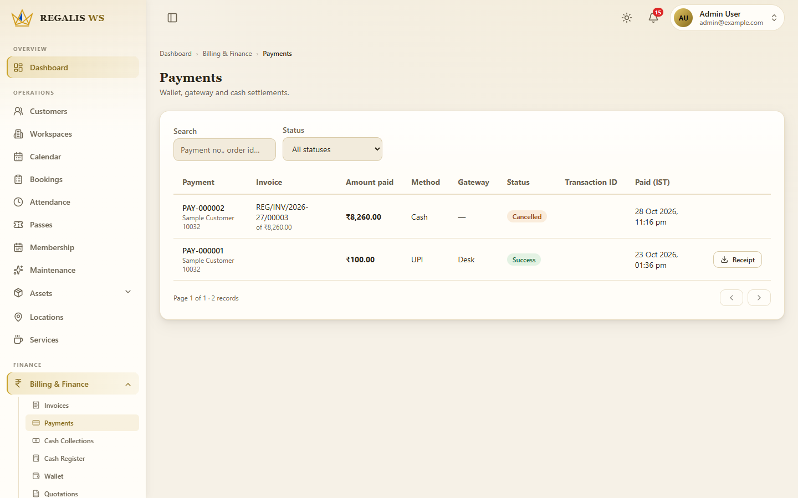

**Header.** "Payments", with the subtitle "Wallet, gateway and cash settlements." Data comes from `GET /api/payments`, always ordered by newest `PaymentId` [DC PaymentService.cs:50].

**Filters**
- **Search** ("Payment no., order id…"): matches `PaymentNumber` or `GatewayOrderId` only. **Not the customer name** [DC PaymentService.cs:45-49].
- **Status:** Pending, Success, Failed, Refunded, Cancelled.

There is no date filter, in the UI or the API.

**Columns**
| Column | Content |
|---|---|
| Payment | Payment number (`PAY-000001`); customer name |
| Invoice | Invoice number, or "Booking", or blank; "of ₹x" when linked to an invoice |
| Amount paid | Amount |
| Method | Wallet, UPI, Credit card, Debit card, Net banking, Cash, Other |
| Gateway | Provider name ("Razorpay" / "Sandbox"), "Desk" for a desk wallet top-up [DC WalletDeskService.cs:161], or "—" |
| Status | Green Success, red Failed, amber otherwise |
| Transaction ID | Gateway payment id, with the gateway order id underneath |
| Paid (IST) | Date and time |
| Receipt | Only for Success. Opens the payment receipt PDF (6.2). |

There are no row actions apart from Receipt: no refund and no export.

### 3.3 Wallet — `/admin/billing/wallet` and `/admin/billing/wallet/:customerId`

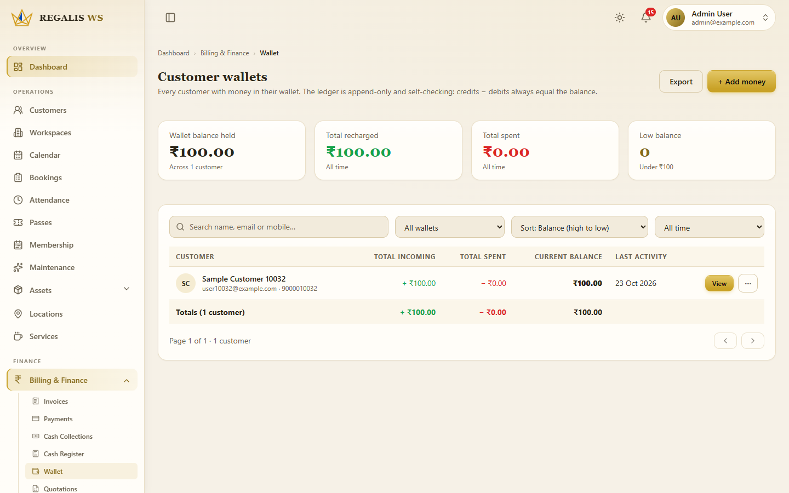

**List page header.** "Customer wallets", with the subtitle "Every customer with money in their wallet. The ledger is append-only and self-checking: credits − debits always equal the balance." The list in fact includes zero-balance wallets: it is every `MST_Wallet` row. Customers who have no wallet row are not listed at all [DC WalletLedgerQueries].

**Cards**
| Card | Figure |
|---|---|
| Wallet balance held | Σ balances, "Across N customers" |
| Total recharged | **Σ of all credits, including refunds, cancellations and admin credit adjustments**, not only recharges [DC WalletLedgerQueries.GetWalletsAsync] |
| Total spent | Σ all debits |
| Low balance | Count of wallets under `Wallet.LowBalanceThreshold` (100 in production) [DB-P] |

**Toolbar**
- **Search:** name, email or mobile.
- **Show:** All / With balance / Zero balance / Low balance (the last includes zero).
- **Sort:** balance high→low (default) or low→high, name, last activity, total spent.
- **Activity:** all time / active 30 days / active 90 days / no activity for 90+ days.

**Columns.** Customer (name, email · mobile) | Total incoming | Total spent | Current balance (red when low) | Last activity | **View** plus a "⋯" menu: View wallet; Add money and Adjust balance (WALLET.EDIT only); Export statement. A totals row follows the filter.

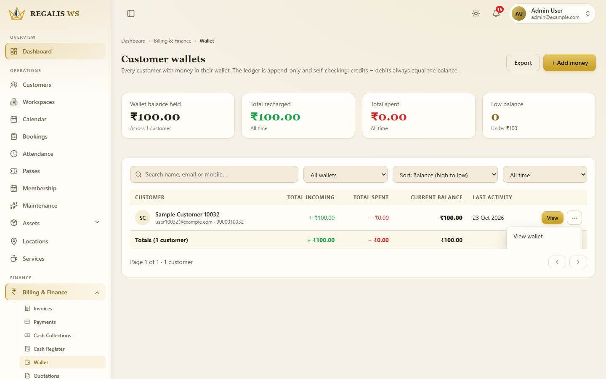

**Buttons**
- **Export:** CSV of the filtered list, max 10,000 rows, with a UTF-8 BOM. It prefixes `'` to cells starting with `= + - @` to stop spreadsheet formulas [DC WalletLedgerQueries.Cell]. It needs only WALLET.VIEW.
- **+ Add money** (WALLET.EDIT): opens a customer picker, then the customer's page with the add-money dialog.

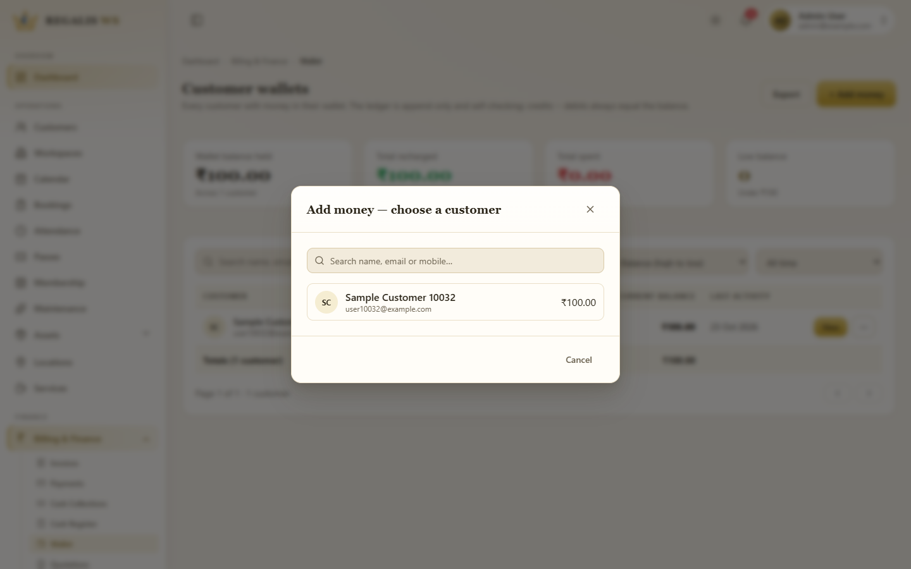

**Customer wallet page**

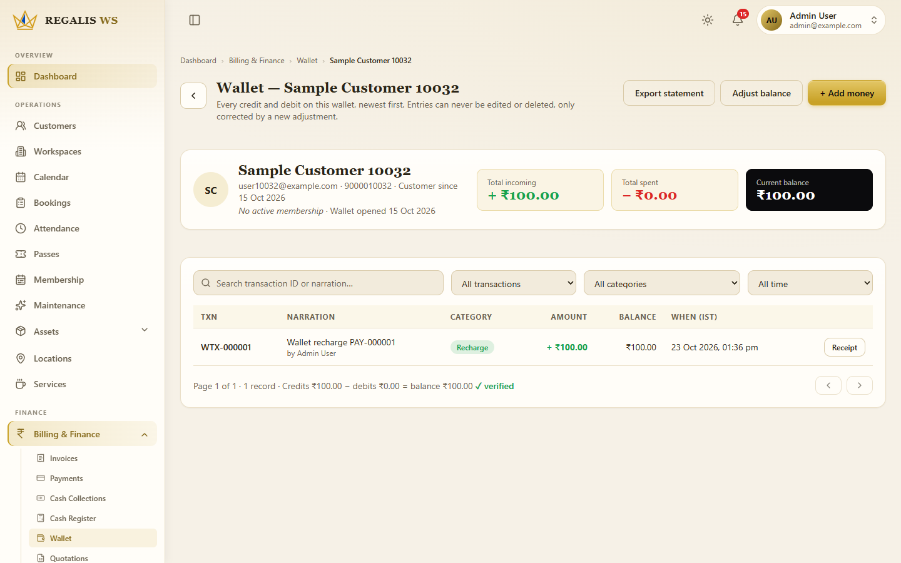

| Part | Content |
|---|---|
| Header | "Wallet — {name}", with the subtitle "Entries can never be edited or deleted, only corrected by a new adjustment." Buttons: **Export statement** (PDF or CSV, current period only); **Adjust balance** and **+ Add money** (WALLET.EDIT). |
| Profile | Email · mobile · customer since; active membership or "No active membership"; wallet opened date; Total incoming, Total spent, Current balance |
| Filters | Search transaction id or narration; Credits / Debits; Category (Recharge, Booking, Refund, Day pass, Membership, Service, Deposit, Adjustment); Period (all time, this month, last month, last 30 / 90 days, custom) |
| Ledger columns | Txn (`WTX-000001`) · Narration (with "by {staff}" when staff did it) · Category · Amount · Balance after · When (IST) · **Receipt** (only on Recharge rows with a successful payment) |
| Footer check | "Credits ₹a − debits ₹b = balance ₹c ✓ verified", or "⚠ stored balance differs" when the ledger total and `MST_Wallet.Balance` disagree [DC WalletDeskService.GetWalletAsync :128] |

**Add money dialog** (desk top-up, `POST /api/admin/wallets/{id}/add-money`)

Fields:
- Amount: up to ₹10,00,000, 2 decimals.
- Payment mode: UPI, Cash, Debit card, Credit card, Bank transfer, Other.
- Reference / UTR.
- Received on: not in the future, and within the last 365 days.
- Narration: prefilled "Wallet recharge PAY-…".
- "Notify the customer and send the receipt" checkbox.

In one transaction it writes three things [DC WalletDeskService.AddMoneyAsync :133-208]:
- a `TRN_Payment` (gateway "Desk", status Success);
- a wallet credit (category Recharge);
- an audit row `WALLET_ADD_MONEY`.

No invoice is raised and there is no GST. The server refuses with "Wallet top-up at the desk is switched off…" when setting `Wallet.DeskAddMoneyEnabled` is false. **That setting does not exist in production, and the code's fallback is `true`, so desk top-up is on** [DB-P MST_AppSetting; DC WalletDeskService.cs:135]. Desk top-ups **do not apply** `Wallet.MinRecharge` (1000) or `Wallet.MaxRecharge` (50000).

**Adjust balance dialog** (`POST /api/admin/wallets/{id}/adjust`)

Fields:
- Credit or Debit.
- Amount: up to ₹10,00,000.
- Reason: suggestions are Booking correction, Goodwill credit, Duplicate charge reversal, Refund correction, Opening balance, Other.
- Narration: shown to the customer.

A debit larger than the balance is refused. The adjustment writes audit row `WALLET_ADJUST` [DC WalletDeskService.AdjustAsync :210-254]. There is no approval step and no limit per person.

### 3.4 Quotations

#### List — `/admin/billing/quotations`

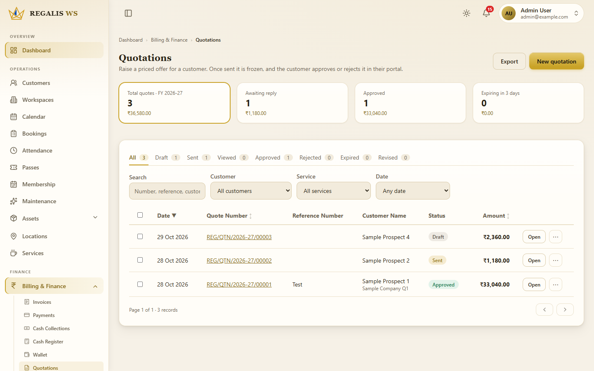

**Header.** "Quotations", with the subtitle "Raise a priced offer for a customer. Once sent it is frozen, and the customer approves or rejects it in their portal." Buttons: **Export** (QUOTATION.EXPORT; CSV with the current filters) and **New quotation** (QUOTATION.CREATE).

**Cards.** These come from `GET /api/quotations/summary` and always cover **the current financial year only, ignoring every filter** [DC QuotationService.GetSummaryAsync :131-162].

| Card | Figure | Clicking it |
|---|---|---|
| Total quotes · FY | Count and value of all quotations dated in the FY, any status | — |
| Awaiting reply | Sent + Viewed, not past valid-until | Opens the **Sent** tab only, so Viewed quotations counted in the card are missing from the table |
| Approved | Count and value | — |
| Expiring in 3 days | Sent/Viewed expiring within 0–3 days | Applies an `expiringInDays=3` filter |

**Tabs.** All, Draft, Sent, Viewed, Approved, Rejected, Expired, Revised, each with a count. **There is no Cancelled tab**: cancelled quotations appear only under All.

**Filters**
- **Search:** number, customer name, company, mobile, reference or subject.
- **Customer:** the dropdown loads **only the first 200 customers**.
- **Service:** Cabin, Desk, Meeting Room, Pass, Other.
- **Date:** Today, This week, This month, Last month, This quarter, This FY, Last FY, Custom.

**Columns.** Checkbox | Date (sortable) | Quote Number (link) | Reference Number (or the subject) | Customer Name (+ company) | Status | Amount (sortable) | Open + "⋯".

- **The checkboxes and "select all" do nothing.** No bulk action exists; the selection only displays a count.
- The "⋯" menu shows only the actions the server allows (7.2).
- **"Open invoice {no}" goes to the invoice list, not to that invoice.**

#### New / edit quotation

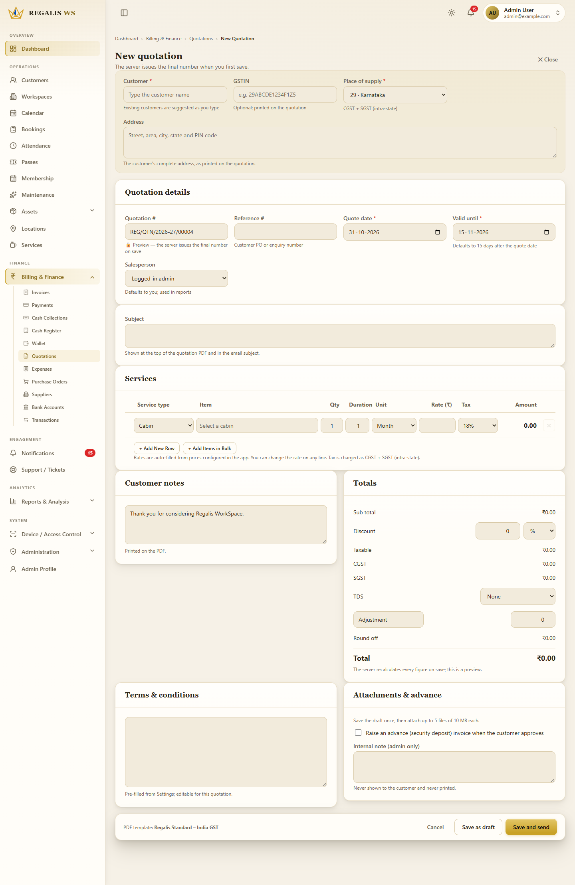

| Section | Fields |
|---|---|
| Customer | Customer (free text, suggests from the first 200 customers; picking one links the customer record); GSTIN (format-checked, no checksum); Place of supply (37 state codes, default `Quotation.HomeStateCode` = 29 Karnataka); Address |
| Quotation details | Quotation # (a preview only — "the server issues the final number on save"); Reference #; Quote date (today); Valid until (today + `Quotation.ValidityDays` = 15); Salesperson (staff; default the logged-in user); Subject |
| Services grid | Service type, Item, Qty, Duration, Unit, Rate (₹), Tax, Amount. Up to 100 lines. Buttons "+ Add New Row" and "+ Add Items in Bulk". |
| Other | Customer notes (default "Thank you for considering Regalis WorkSpace."); Totals preview with discount (% or ₹), TDS (194-I or 194-J at 10%), round off; Terms; Attachments (after the first save); "Raise an advance (security deposit) invoice when the customer approves"; Internal note |
| Footer | Cancel, Save as draft, Save and send |

**Allowed units by service:**
- Cabin and Desk: Month, Day.
- Meeting Room: Hour, Day.
- Pass: One-time.
- Custom line: Hour, Day, Month, One-time.

Rates are pre-filled from the workspace and pass catalogue. Tax per line comes from `Quotation.GstRateOptions` (0, 5, 12, 18, 28; default 18), or the line is ticked "Non-Taxable" [FE AdminQuotationPages :886-914].

**There is no HSN/SAC field on the form**, so new quotation lines never carry an HSN/SAC code. The note on the form says "The server recalculates every figure on save; this is a preview." The server-side calculation is in 4.2.

#### Quotation detail

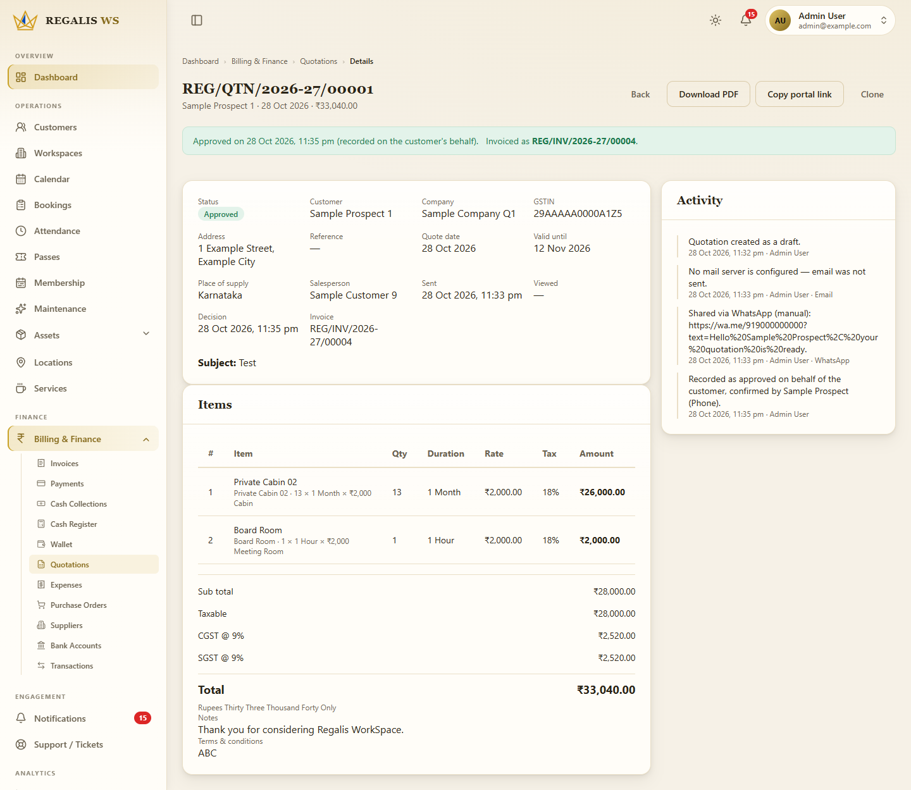

| Part | Content |
|---|---|
| Header buttons | Server-decided (7.2): Back, Edit, Send/Resend, Download PDF, Copy portal link, Mark approved, Mark rejected, Revise, Clone, Convert to invoice, Cancel, Delete |
| Banners | Draft: "This is a draft — the customer cannot see it yet." Sent: "Waiting for the customer to open it. Valid until …". Approved: "Approved on … (recorded on the customer's behalf). Invoiced as …" |
| Facts | Status, customer, company, GSTIN, address, reference, quote date, valid until, place of supply, salesperson, sent, viewed, decision, invoice, subject |
| Items | #, Item, Qty, Duration, Rate, Tax, Amount; then Sub total, Taxable, CGST/SGST or IGST, Total, amount in words, notes, terms |
| Activity | Every event, e.g. "No mail server is configured — email was not sent.", "Shared via WhatsApp (manual): https://wa.me/…" |

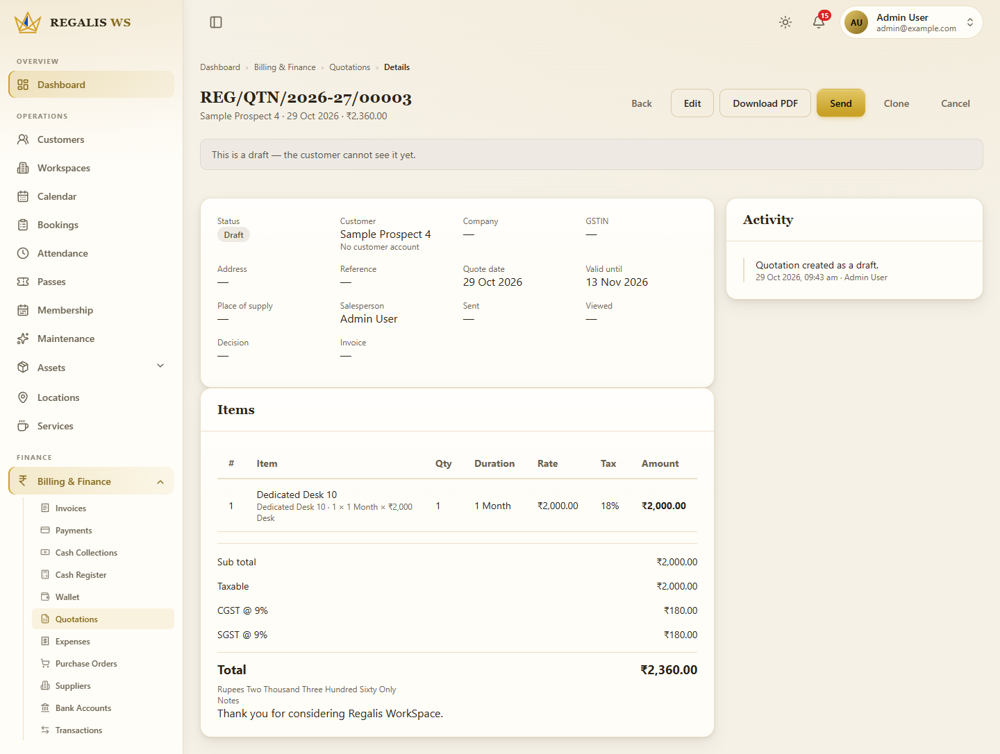
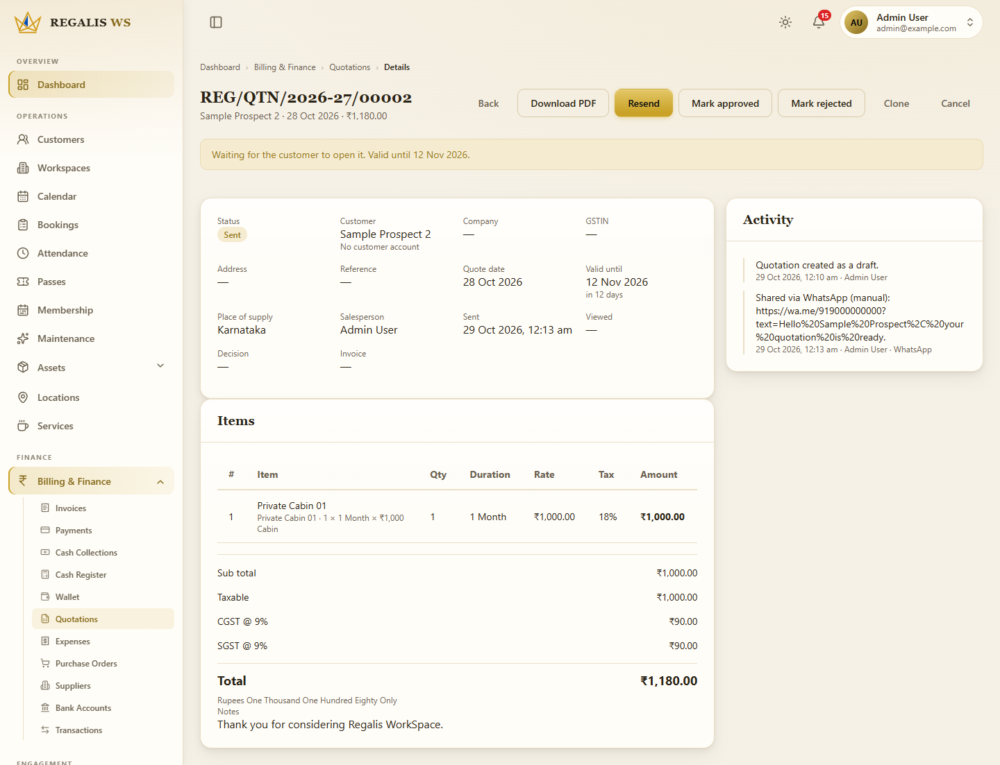

**Send dialog**
- Email: To, Cc, Bcc me, Subject, Message.
- WhatsApp: number and message.
- Placeholders: `{customer_name} {quote_number} {total} {valid_until} {portal_link}`.

**Record decision on the customer's behalf** ("Mark approved" / "Mark rejected"):
- Confirmed by.
- Mode: Phone / In person / Email / WhatsApp.
- Reason, when rejecting: price, other space, requirement, timing, other.
- Note.

**Attachments**
- Draft only, max 5, ≤ 10 MB.
- Types: pdf, jpg, png, docx, xlsx. Checked by file signature [DC QuotationService :603-700].
- **The attachment links on the detail page are plain links that send no login token**, while the API only accepts a Bearer header. Clicking one should return 401 [FE AdminQuotationPages :3161-3165; DC Program.cs:131]. Not exercised live.

### 3.5 Expenses — `/admin/billing/expenses`

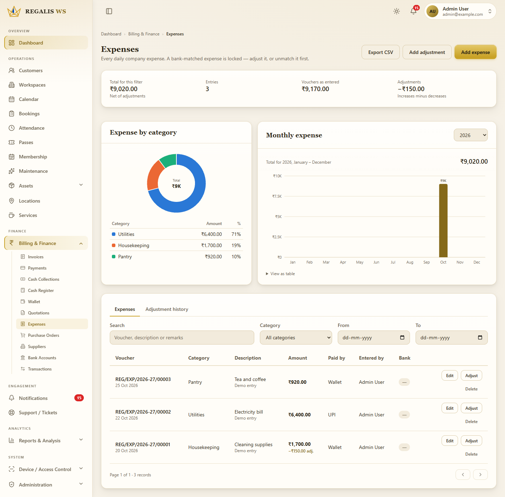

**Header.** "Expenses", with the subtitle "Every daily company expense. A bank-matched expense is locked — adjust it, or unmatch it first." Buttons:
- **Export CSV** (EXPENSE.EXPORT).
- **Add adjustment** (EXPENSE.EDIT).
- **Add expense** (EXPENSE.CREATE).

**Summary strip**
| Figure | Meaning |
|---|---|
| Total for this filter | Σ (amount + adjustments), "Net of adjustments" |
| Entries | Count |
| Vouchers as entered | Σ amount |
| Adjustments | Σ increases − Σ decreases |

**Charts**
- **"Expense by category"** donut: the top 5 categories, the rest folded into "Other". Clicking a slice filters by that category.
- **"Monthly expense"** columns, Jan–Dec, for a chosen year, with "View as table".
- **Adjustments count in the month of the original expense**, not the month of the adjustment [DC ExpenseService :48-91].

**Tabs.** Expenses | Adjustment history.

**Expenses tab**
- **Filters:** Search (voucher, description, remarks), Category, From, To. The API also filters by payment method, location and supplier; the UI does not offer these.
- **Columns:**
  - Voucher (`REG/EXP/2026-27/00001` + date), Category, Description (+ remarks).
  - Amount: net, with a "+/−₹x adj." link to the history.
  - Paid by, Entered by.
  - Bank: "Matched" when any bank line points to it.
- **Actions:**
  - Edit (EXPENSE.EDIT, not bank-matched).
  - Adjust (EXPENSE.EDIT, **allowed even when bank-matched**).
  - Delete (EXPENSE.DELETE, not bank-matched). Deleting is a soft delete: "The voucher is retained for audit."

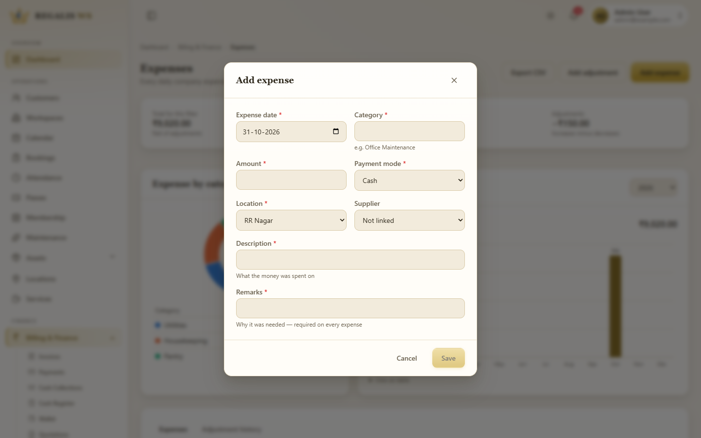

**Add / edit expense**
| Field | Rule |
|---|---|
| Expense date | Default is the browser's **UTC** date. Between 00:00 and 05:30 IST that pre-fills yesterday. |
| Category | **Free text.** There is no category master; the filter list is the distinct values already used [DC ExpenseService.GetCategoriesAsync :93-99]. |
| Amount | > 0 |
| Payment mode | Default Cash. Options are Wallet, UPI, Credit card, Debit card, Net banking, Cash, Other. "Wallet" (the customer wallet type) is offered for a company expense. |
| Location | Required |
| Supplier | Optional, first 100 suppliers |
| Description | Required |
| Remarks | **Required by the server** ("Remarks are required on an expense."), although swagger marks it optional [DC SaveExpenseRequestValidator; LIVE: API returned 400 without it] |

The form has **no GST fields, no bill number, no attachment upload and no PO picker**. Edit and delete are refused while a bank line is matched to the expense.

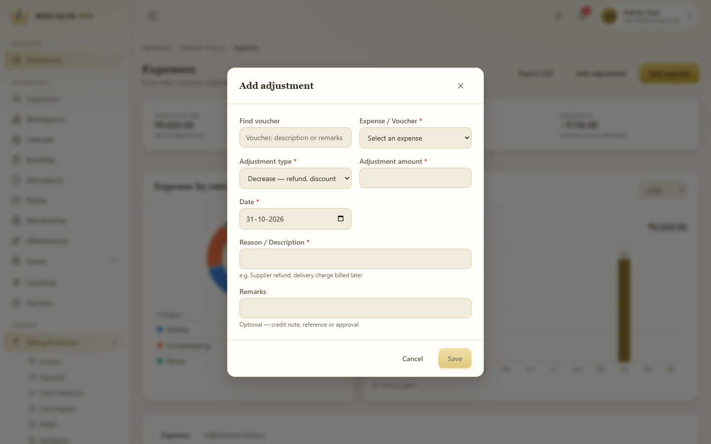

**Adjustment**
- **Type:** Increase (extra charge) or Decrease (refund, discount, correction); the default is Decrease.
- **Amount** > 0, a date, and a **Reason** (required).
- An expense can be reduced to nil at most. Enforced in code and by constraint `CK_Expense_NetAmount ([Amount]+[AdjustmentTotal])>=0` [DB-P].

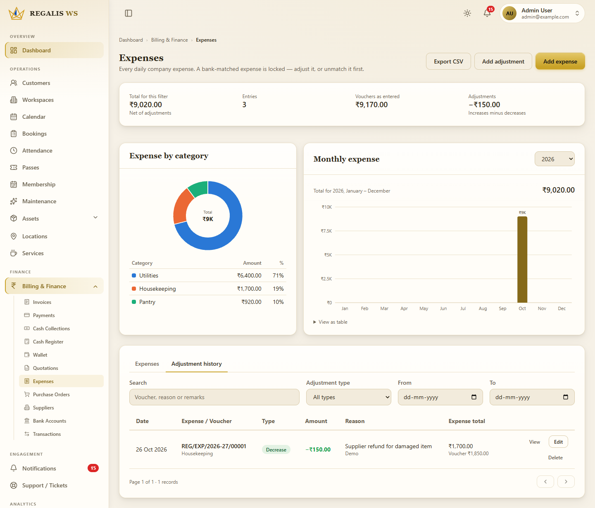

**Adjustment history tab**
- **Filters:** search, type, from, to.
- **Columns:** Date | Expense / Voucher | Type | Amount (signed) | Reason | Expense total (net and voucher) | View / Edit / Delete.

### 3.6 Purchase Orders

#### List — `/admin/billing/purchase-orders`

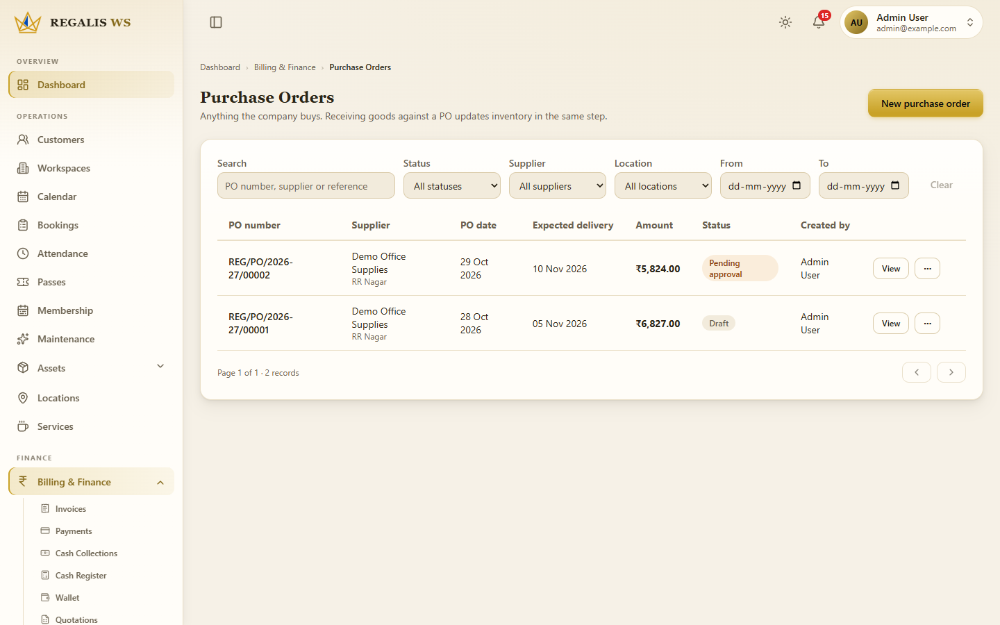

**Header.** "Purchase Orders", with the subtitle "Anything the company buys. Receiving goods against a PO updates inventory in the same step." **New purchase order** needs PURCHASE.CREATE.

**Filters.** Search (PO number, supplier, reference); Status (all 7); Supplier (first 100); Location; From and To (PO date); Clear. The order is fixed: PO date newest first [DC PurchaseOrderService.cs:95].

**Columns**
- PO number (+ reference), Supplier (+ location), PO date.
- Expected delivery, with "· overdue" when past and the status is Approved, Sent, Partial, Pending **or Draft**. This is computed in the browser only.
- Amount, Status, Created by, View + "⋯".

**"⋯" menu** (each item gated as stated)
| Item | Shown when |
|---|---|
| Edit | Draft, PURCHASE.EDIT |
| Download PDF | Always |
| Submit for approval | Draft, approval required, PURCHASE.CREATE |
| Approve | Pending + PURCHASE.APPROVE, or Draft when approval is off |
| Reject | Pending, PURCHASE.APPROVE |
| Send to supplier | Approved, PURCHASE.APPROVE |
| Receive goods | Sent / Partially received, PURCHASE.EDIT |
| Cancel PO | Not cancelled, not received, nothing received, PURCHASE.DELETE |

#### New / edit PO

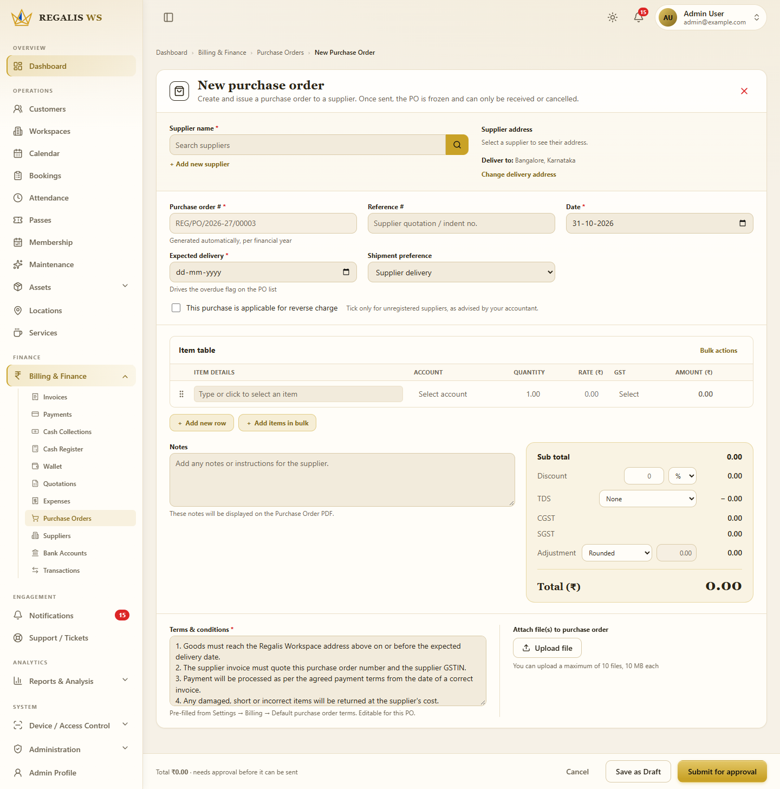

**Header fields**
- **Supplier:** search, with "+ Add new supplier" and "Edit supplier". The picker requests 200 suppliers, but **the server caps a page at 100, so only the first 100 suppliers alphabetically can be chosen**.
- **Deliver to**, with "Change delivery address".
- **Purchase order #:** a read-only preview.
- **Reference #**, **Date**, **Expected delivery** (required to issue), **Shipment preference**.
- **Reverse-charge** checkbox ("Tick only for unregistered suppliers, as advised by your accountant.").

**Item table**
- Item (stock item or free text), Account, Quantity (3 dp), Rate (2 dp), GST %, Amount.
- Row menu: unit and HSN/SAC, duplicate, move.
- Bulk actions: add in bulk, copy row 1's account or GST to every row, remove empty rows.
- **The form has no per-line discount input; it always sends 0.**

**Summary**
- Sub total, Discount (% or ₹), TDS section (194C 1%/2%, 194J 10%, 194I 10%, 194Q 0.1%), Adjustment, Total.
- The **Adjustment defaults to "Rounded"**, which rounds every PO total to the whole rupee, saved as an adjustment labelled "Round off" [FE AdminPurchaseOrderPages :1313, :1394-1395].

**Other.** Terms & conditions (required to issue, prefilled from `Purchase.TermsAndConditions`) and attachments (max 10, ≤ 10 MB, uploaded after the PO is created).

**Footer.** Cancel, Save as Draft, and "Submit for approval" (approval on) or "Save & approve" (approval off). Approval is **on** in production: `Purchase.RequireApproval=true` [DB-P].

**Inline "Add new supplier".** The default code is `SUP-` plus the last 5 digits of the current time in milliseconds. That repeats every 100 seconds, so it can collide; the server then answers 409.

#### PO detail

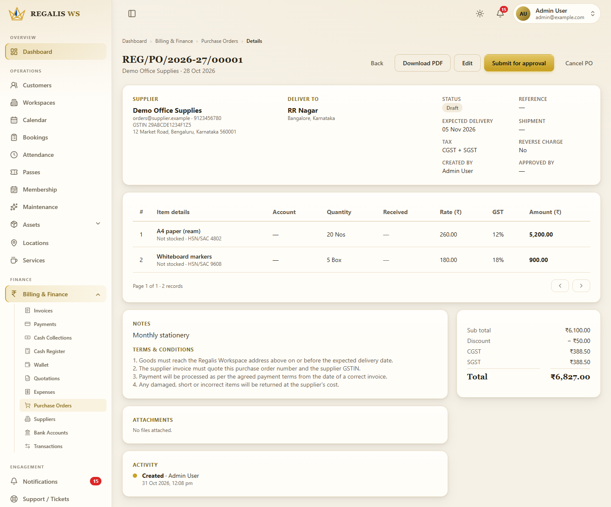

| Part | Content |
|---|---|
| Buttons | Back, Download PDF, Edit, Reject, Submit for approval, Approve, Send to supplier, Receive goods, Cancel PO, with the same rules as the list |
| Banners | "Frozen." (Sent / Partial / Received); "Awaiting approval." (Pending); "Cancelled: {reason}" |
| Cards | Supplier (name, email · mobile, GSTIN, address); Deliver to; Status, Reference, Expected delivery, Shipment, Tax (CGST + SGST or IGST), Reverse charge, Created by, Approved by |
| Lines | #, Item details ("Not stocked" or the item code, HSN/SAC), Account, Quantity, Received ("x of y"), Rate, GST, **Amount = quantity × rate, before any discount** |
| Totals | Sub total, Discount, CGST/SGST or IGST, TDS, Adjustment, Total |
| Other | Notes, Terms, Attachments, Activity (newest first) |

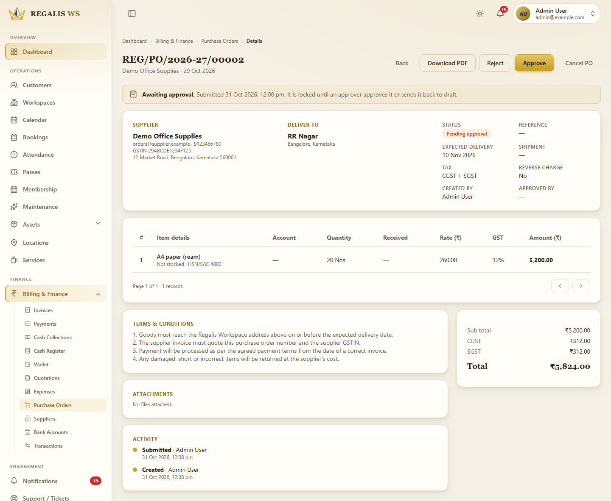

**Receive goods dialog**
- Received date: defaults to the browser's **UTC** date.
- Supplier invoice no.
- A quantity per pending line, defaulting to the full pending quantity.
- Notes.

"Send to supplier" is labelled "Mark as sent" in its dialog: **nothing is emailed to the supplier** [DC PurchaseOrderService.SendAsync :260-273].

### 3.7 Suppliers — `/admin/billing/suppliers`

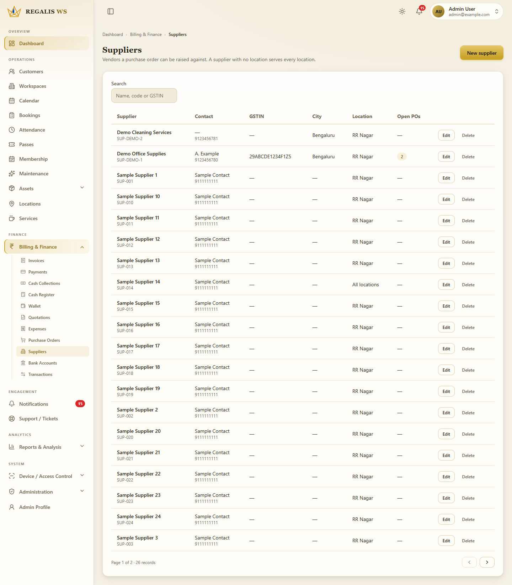

**Header.** "Suppliers", with the subtitle "Vendors a purchase order can be raised against. A supplier with no location serves every location." **New supplier** needs SUPPLIER.CREATE.

**Filters.** Search only (name, code or GSTIN). The API also filters by location and active state; the UI does not.

**Columns.** Supplier (name, "Inactive" badge, code) | Contact | GSTIN | City | Location ("All locations" when none) | Open POs (counts every PO not Received or Cancelled, **including drafts** [DC SupplierService.cs:114]) | Edit / Delete.

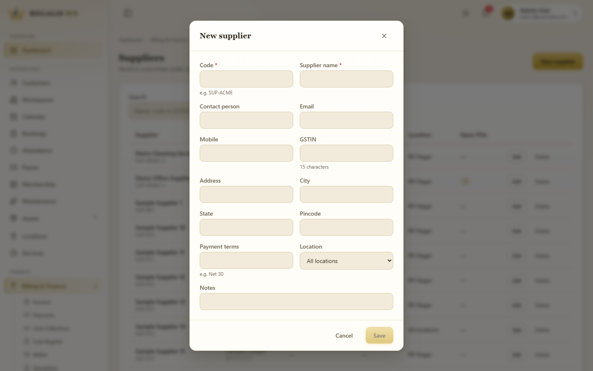

**Supplier fields.** Code*, Supplier name*, Contact person, Email, Mobile, GSTIN, Address, City, State, Pincode, Payment terms (free text, "not interpreted by the engine"), Location, Notes.

Validation:
- GSTIN: 15-character pattern, no checksum, and not unique.
- Pincode: `^[1-9][0-9]{5}$`.
- Code: upper-cased and unique.

There is **no PAN field** and **no active/inactive switch**.

**Delete** is refused if the supplier has *any* PO, including cancelled ones. The message then says "A supplier with purchase orders cannot be deleted — deactivate it instead." **There is no way to deactivate a supplier.** The save request has no `IsActive` field and no code ever sets it [DC SupplierService.Apply :117-131], so the "Inactive" badge can never appear.

### 3.8 Bank Accounts — `/admin/billing/bank-accounts`

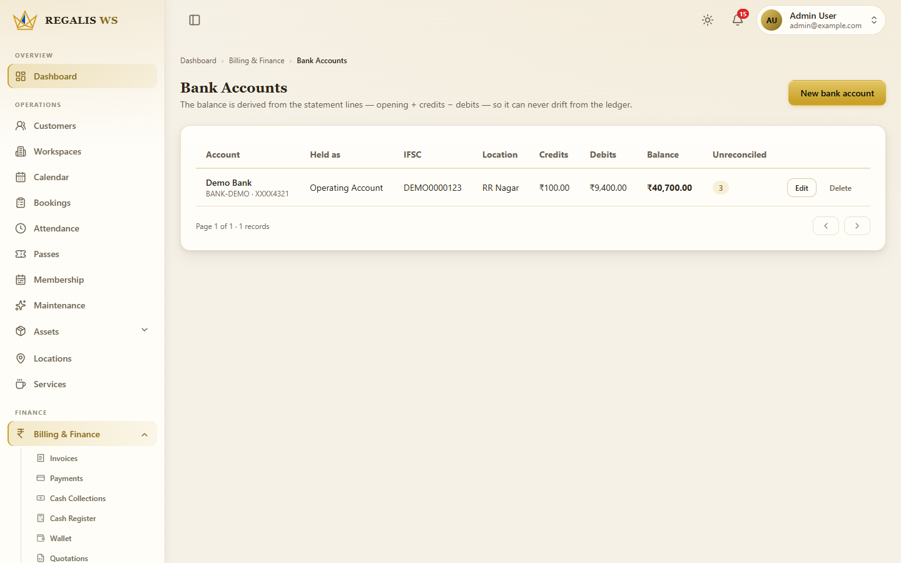

**Header.** "Bank Accounts", with the subtitle "The balance is derived from the statement lines — opening + credits − debits — so it can never drift from the ledger." **New bank account** needs BANK.CREATE.

**Columns.** There is no filter. Account (bank name, code · masked number) | Held as | IFSC | Location ("Company-wide") | Credits | Debits | **Balance** | Unreconciled (count of lines not yet Reconciled, which includes Matched ones) | Edit / Delete.

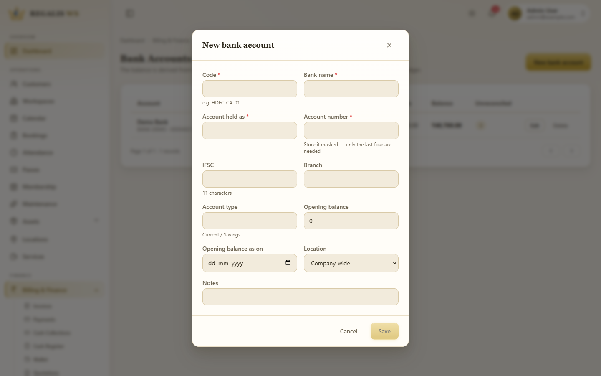

**Fields**
- Code* (e.g. HDFC-CA-01, upper-cased, unique).
- Bank name*, Account held as*.
- Account number*: the hint says "Store it masked", but **the full number is accepted** (length ≤ 40 only).
- IFSC (`^[A-Z]{4}0[A-Z0-9]{6}$`), Branch, Account type.
- Opening balance (frozen once the account has lines), Opening balance as on, Location, Notes.

**Balance rule:** opening balance + Σ credits − Σ debits over **all** lines, whatever their status and date. "Opening balance as on" is stored but **never used** [DC BankService.ShapeAccountsAsync :379-407].

**Delete** is refused if the account has lines, with "deactivate it instead". **There is no way to deactivate a bank account** [DC BankService.ApplyAccount :434-446].

### 3.9 Transactions ("Bank Statement") — `/admin/billing/transactions`

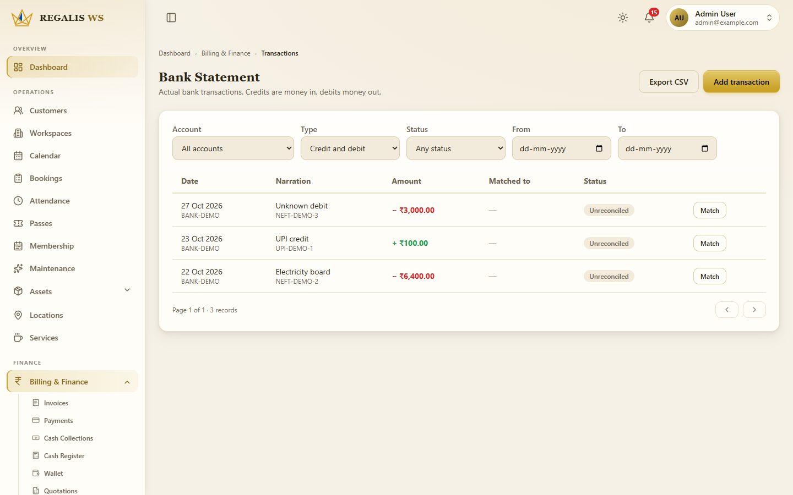

The sidebar item says "Transactions"; the page title says **"Bank Statement"**. The subtitle reads "Actual bank transactions. Credits are money in, debits money out."

**Buttons.** Export CSV (BANK.EXPORT) and Add transaction (BANK.CREATE).

**Filters.** Account, Type (Credit / Debit), Status (Unreconciled / Matched / Reconciled), From, To.

**Columns.** Date (+ account code) | Narration (+ reference, bank id, category) | Amount (green + credit, red − debit) | Matched to (payment or expense number, who, when) | Status.

**Actions**
| Button | Shown when | Does |
|---|---|---|
| Match | BANK.EDIT, line Unreconciled | Opens the match dialog |
| Reconcile | BANK.RECONCILE, line Matched | Moves the line to Reconciled |
| Unmatch | BANK.EDIT, line Matched **or Reconciled** | Back to Unreconciled. **Someone without BANK.RECONCILE can undo a reconciliation.** |

There is no edit or delete for a line in the UI, although the API has both (Unreconciled lines only).

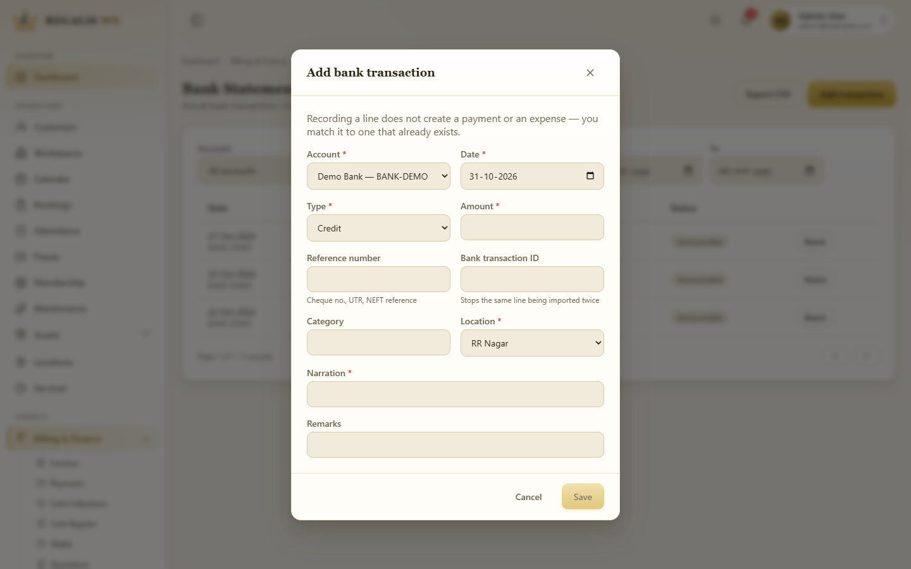

**Add transaction**
- Account*, Date* (UTC default), Type*, Amount* (> 0).
- Reference number, Bank transaction ID (unique per account), Category.
- Location*: required even for a company-wide account.
- Narration*, Remarks.

The dialog says: "Recording a line does not create a payment or an expense — you match it to one that already exists." **Every line is typed by hand.** There is no statement import (section 11).

### 3.10 Reconciliation — hidden page, reachable by URL

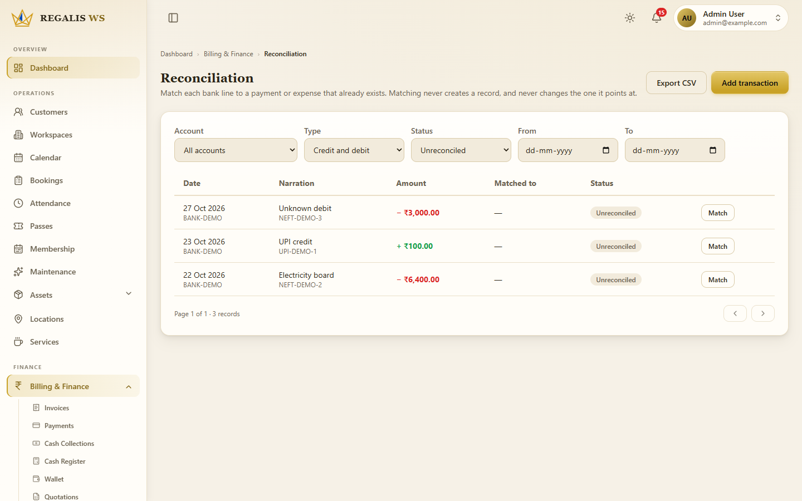

**Finding.** This is a working page that is in production but has no menu entry for anyone.

| Question | Answer | Evidence |
|---|---|---|
| Can it be reached by typing the URL? | **Yes.** | The route `reconciliation` is in the production bundle, guarded only by `Ne{permission:"BANK.VIEW"}`, which checks the permission and ignores menus [FE index-DI5X4c9f.js]. The menu row is `MST_Menu` 62 "Reconciliation", `IsActive=0, IsDeleted=1`, and still points to the old URL `/admin/bank/reconciliation`, which itself redirects to the new one [DB-P]. |
| Does it work, or error? | **It works.** | [LIVE] Typed URL as Administrator: page rendered; `GET /api/bank/accounts` and `GET /api/bank/transactions` returned 200; the Match dialog opened and listed candidates (below). Typed URL as an Operations Manager (who has no bank menus): page rendered, the same calls returned 200 (screenshot below). |
| Which permission guards it? Who holds it today? | **BANK.VIEW** opens it. Its actions need BANK.EDIT (match/unmatch), BANK.RECONCILE (reconcile), BANK.CREATE (add line) and BANK.EXPORT (export) [DC BankController :19-139]. BANK.VIEW is held by **Administrator, Operations Manager and Finance**. BANK.EDIT, CREATE and RECONCILE are held by **Administrator and Finance** only. | [DB-P MAP_RolePermission], identical in Dev |

**What the page is.** It is **the Transactions component with the Status filter preset to "Unreconciled"** (`ne({mode:"reconcile"})` versus `ne({mode:"all"})`) [FE AdminBankPages-BZwouxUO.js]. Its subtitle reads "Match each bank line to a payment or expense that already exists. Matching never creates a record, and never changes the one it points at."

Because the default filter is Unreconciled, **lines in status Matched are hidden**, even though they still need the Reconcile click. The empty state then reads "Nothing left to reconcile — Every line in this window has been matched and confirmed", which is untrue while Matched lines exist.

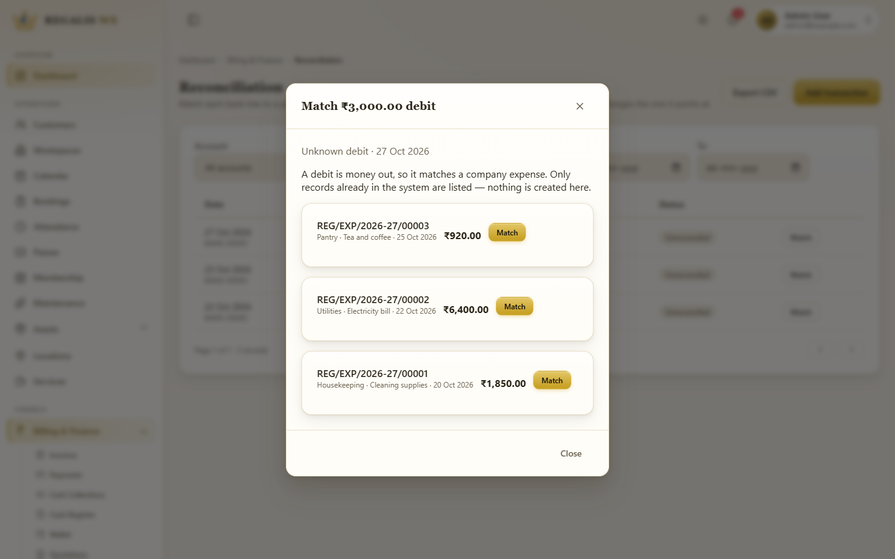

**Match dialog**
- Lists candidates within **±7 days** of the bank date [DC BankService :40, :174-218]:
  - for a **credit**, payments with status Success, from any gateway, including desk wallet top-ups and cash;
  - for a **debit**, expenses of any payment mode.
- Candidates with an exactly equal amount get an "Exact amount" badge and are listed first. For expenses the comparison uses the **gross voucher amount, ignoring adjustments**.
- **The amount is never checked when matching.** The dialog above offers ₹920, ₹6,400 and ₹1,850 expenses for a ₹3,000 debit, and any of them can be matched [LIVE; DC BankService.MatchAsync :220-264].
- Matching is one-to-one only: no splits and no many-to-one.

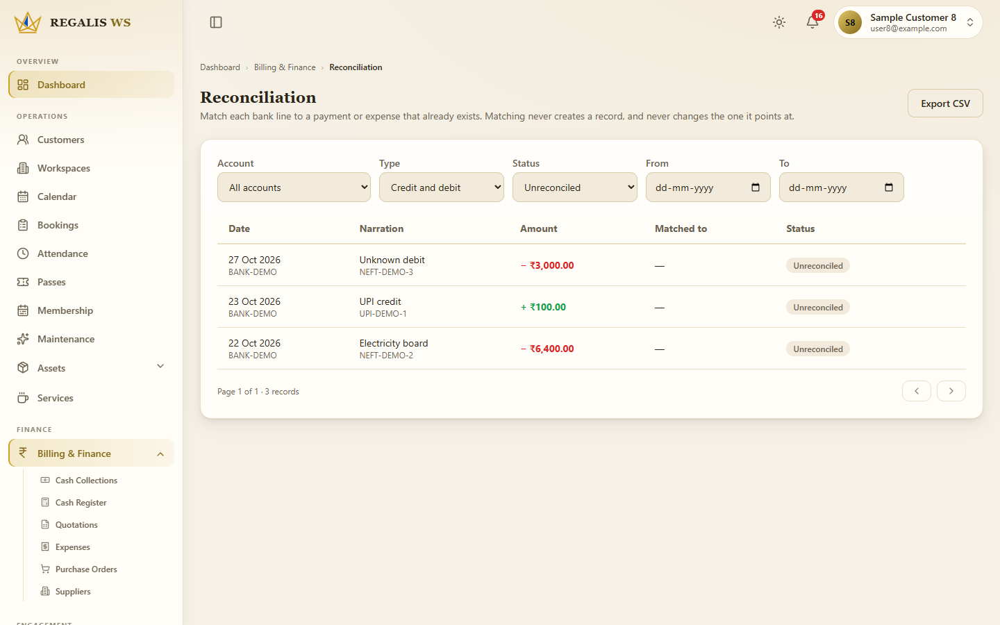

As the Operations Manager, the page shows Export CSV but no Add transaction, Match or Reconcile buttons, because those need permissions this role does not hold.

---

## 4. The money rules

### 4.1 Unit of storage and rounding

- **Unit of storage.** Every amount is stored in **rupees as SQL `decimal(18,2)`**, not paise:
  - invoices, payments, quotations, POs, expenses, bank lines and wallet rows;
  - percentages are `decimal(5,2)`;
  - quantities and durations are `decimal(18,3)`.

  Source: [DB-P INFORMATION_SCHEMA.COLUMNS on TRN_Invoice, TRN_InvoiceLine, TRN_Payment, TRN_Quotation*, TRN_PurchaseOrder*, TRN_Expense*, TRN_BankTransaction, MST_Wallet, TRN_WalletTransaction].
- **Paise conversion.** The only place paise appears is the Razorpay adapter: `(long)Math.Round(amount * 100m, 0)` [DC RazorpayPaymentGateway.cs:41].
- **Rounding.** Where the server rounds, it uses `Math.Round(x, 2, MidpointRounding.AwayFromZero)`, which rounds half up [DC BookingService.TaxedAsync :747-761; QuotationService :875; PurchaseOrderPricing :78-81].
- **Fields not rounded or validated.** Expense and bank amounts have no scale validator. A third decimal is left to SQL's `decimal(18,2)` conversion. **NOT CONFIRMED** whether that rounds or truncates in practice: I found no validator, and I did not test an insert.
- **Display.** Amounts are shown with `Intl.NumberFormat("en-IN", {currency:"INR", maximumFractionDigits:2})` [FE formatters-DFe5xCRi.js].

### 4.2 How each document's totals are calculated

**Booking invoice** [DC BookingService.TaxedAsync :747-761; BuildInvoiceAsync :408-490]

1. base = round(price per hour × minutes ÷ 60). Monthly bookings use the month price × months.
2. CGST = round(base × `Tax.CgstPercent` ÷ 100). SGST = round(base × `Tax.SgstPercent` ÷ 100). Both are 9 in production [DB-P].
3. total = base + CGST + SGST.
4. On the invoice: SubTotal = base; Discount = booking discount; Taxable = base − discount; IGST = 0; Total = booking total.
5. The invoice recomputes CGST on the **pre-discount base** and gives SGST the remainder. **With a discount, CGST and SGST would differ.** Nothing writes a booking discount today, so this is latent [DC BookingService.cs:412-417, :431].
6. There is **no round-off to the rupee** on booking or pass invoices.

**Booking extension invoice.** The same formula on the extra minutes. The invoice is always Paid, and due date = invoice date [DC BookingMutationService :225-296].

**Pass / membership invoice.** Taxable = plan price minus any upgrade credit; CGST/SGST from the same settings; quantity 1 [DC PassService :331-364].

**Quotation** [DC QuotationService.ApplyLinesAndTotalsAsync :790-909]. The server recalculates every figure and ignores the browser's totals.

1. Line gross = round(qty × (duration or 1) × rate). Line amount = gross − line discount (the discount is capped at gross).
2. SubTotal = Σ line amounts.
3. Quote discount = % of SubTotal, or a fixed ₹. A discount over SubTotal is refused.
4. The quote discount is spread over the lines in proportion to their amounts; **the last line takes the rounding remainder**.
5. Per line: taxable = amount − share; tax = round(taxable × rate ÷ 100). **GST is computed per line.**
6. Intra-state if place of supply is **blank** or equals `Quotation.HomeStateCode` (29): CGST = round(tax ÷ 2), SGST = tax − CGST. Otherwise IGST = tax.
7. TDS (optional) = round(taxable × TDS% ÷ 100), **subtracted** from the total.
8. pre = taxable + CGST + SGST + IGST − TDS + adjustment.
9. Round-off = round(pre to the rupee) − pre, when `Quotation.RoundOffEnabled` is true (it is, in production).
10. Total = pre + round-off. A negative total is refused.

**Invoice raised from a quotation.** It copies every header figure verbatim: subtotal, discount, taxable, CGST/SGST/IGST, TDS, adjustment, round-off and total [DC InvoiceService.CreateFromQuotationAsync :129-144]. It does **not** copy each line's discount share. So on a line that took part of a quote discount, line amount + line tax ≠ line total.

**Purchase order** [DC PurchaseOrderPricing :30-81]. The same structure as quotations, with these differences:
- the order-discount remainder goes to the **largest** line;
- TDS = round(Σ taxable × TDS%);
- total = Σ taxable + (reverse charge ? 0 : Σ tax) − TDS + adjustment. Under reverse charge, tax is still computed, stored and printed, but left out of the total;
- inter-state is decided at save time:
  - supplier state = the first two digits of the GSTIN, else the state name;
  - delivery state = the location's state, else 29;
  - a supplier with neither is always CGST + SGST [DC PurchaseOrderService.ApplyAsync :580-587, :736-760].

**Expense.** Net = amount + Σ increases − Σ decreases. It may not go below 0 [DC ExpenseService :260-310; DB-P CK_Expense_NetAmount]. There is no tax.

**Wallet.**
- Balance = Σ credits − Σ debits in `TRN_WalletTransaction`. Each row also stores the balance after it.
- `MST_Wallet.Balance` is updated in the same unit of work, and the admin page flags any difference.
- The balance may not go negative: `CK_Wallet_Balance` [DC WalletService; DB-P].

**Bank account.** Balance = opening + Σ credits − Σ debits over all lines (3.8).

### 4.3 What counts as paid and part-paid (invoices)

| Event | Effect on the invoice | Source |
|---|---|---|
| Booking or pass paid at purchase (wallet or gateway) | Invoice created **Paid** | [DC BookingService :440-443; PassService :322-372] |
| Pay-later booking or pass | Invoice created **Pending** | same |
| Quotation converted | Invoice created **Pending** | [DC InvoiceService :109-205] |
| Online payment against an invoice | PaidAmount += amount. ≥ Total → **Paid** (PaidUtc set); else **PartiallyPaid** | [DC PaymentService.VerifyInvoicePaymentAsync :247-270] |
| Cash collection, or its void | PaidAmount = max(0, PaidAmount ± amount). ≥ Total → Paid; 0 → Pending; otherwise PartiallyPaid | [DC CashCollectionService.ApplyToInvoice :563-583] |

`OutstandingAmount` is a persisted computed column, `TotalAmount − PaidAmount` [DC InvoiceConfiguration.cs:21].

### 4.4 What counts as overdue

**Invoice.** Overdue is calculated, never stored. An invoice is overdue when **due date < today (IST), outstanding > 0, and status is Pending, Sent or PartiallyPaid**. The same rule is used for the badge, the "Overdue only" filter and the admin alert [DC InvoiceService.ToDto :340-347; :65-69; AdminNotificationJobs :116-117].

**Due date**
- Booking, quotation and advance invoices: invoice date + `Invoice.DueDays`, which is 7 in production [DB-P].
- Pass and extension invoices: due on the invoice date.
- **Booking invoices that are already paid still get a due date 7 days out** [DC BookingService.cs:429].
- The PDF prints "Terms: Net 7", or "Due on Receipt" when the days are 0.

**Purchase order.** "Overdue" is a browser-only label: expected delivery before today, on Draft, Pending, Approved, Sent or Partial POs.

**Quotation.** Expired once valid-until has passed, while Sent or Viewed (7.2).

---

## 5. GST

### 5.1 Rates and settings in production [DB-P MST_AppSetting]

| Setting | Production value | Used by |
|---|---|---|
| `Tax.CgstPercent` / `Tax.SgstPercent` | 9 / 9 | Bookings, extensions, passes |
| `Tax.IgstPercent` | 18 | **Nothing reads it.** The only reference is the seeder [DC SeedCatalogue.cs:267]. |
| `Tax.PlaceOfSupply` | empty | Invoice PDF "Place of supply" text |
| `Quotation.HomeStateCode` | 29 (Karnataka) | Quotation and PO intra/inter-state test |
| `Quotation.DefaultGstPercent` / `GstRateOptions` | 18 / 0, 5, 12, 18, 28 | Quotation lines |
| `Purchase.DefaultGstPercent` / `GstRateOptions` | 18 / 0, 5, 12, 18, 28 | PO lines |
| `Company.Gstin` | **empty** | Printed as the seller's GSTIN on invoices, quotations, POs and receipts |
| `Company.Address`, `Company.Phone`, `Company.Bank*` | **empty** | Document headers and the invoice bank block |

### 5.2 The CGST / SGST / IGST split

| Document | Rule |
|---|---|
| Booking, extension and pass invoices | Always CGST + SGST from settings, whatever the customer's state. **IGST is never charged.** |
| Quotation, and invoices from quotations | CGST + SGST when place of supply is blank or 29; otherwise IGST. **A blank place of supply is treated as intra-state.** |
| Purchase order | Supplier state versus delivery state (4.2) |
| Expense | No GST at all |

### 5.3 Place of supply

- The invoice table `TRN_Invoice` has **no place-of-supply column** [DB-P].
- The invoice PDF prints `Tax.PlaceOfSupply` if set, otherwise the home state's name and code, e.g. "Karnataka (29)" [DC InvoiceService :96-107].
- So **an inter-state (IGST) invoice raised from a quotation prints the home state as its place of supply.** The quotation's own place of supply is not copied.
- Quotations store `PlaceOfSupply` and `PlaceOfSupplyStateCode` and print them.

### 5.4 HSN / SAC

- `TRN_InvoiceLine.HsnSacCode` is set only on invoices raised from quotations, copied from the quotation line [DC InvoiceService :166].
- **Booking, extension and pass invoices never set it**, so the HSN/SAC column on those PDFs is blank. The sample in 6.1 shows this.
- There is no default SAC setting: I searched for `Tax.Sac` and `9972` and found nothing.
- The quotation form has **no HSN/SAC input**, so new quotation lines carry none either.
- PO lines have an HSN/SAC field (≤ 20 characters, no format check).

### 5.5 Invoice and document numbering

All numbers come from `MST_NumberSequence`. The next number is taken with an atomic `UPDATE … SET CurrentValue += 1 OUTPUT` inside the caller's transaction, on the newest row for the key [DC NumberSequenceService :23-54].

| Key | Format | Example |
|---|---|---|
| Invoice | `{Prefix}/{FY}/{n:D5}` | REG/INV/2026-27/00001 |
| Quotation | same | REG/QTN/2026-27/00001 (revision: `…-R1`) |
| PurchaseOrder | same | REG/PO/2026-27/00001 |
| Expense | same | REG/EXP/2026-27/00001 |
| Payment | `{Prefix}{n:D6}` | PAY-000001 |
| WalletTransaction | same | WTX-000001 |
| CashReceipt / CashSession | see section 13 | REG/RCPT/2026-27/00001, CRS-000001 |

**Gaps.** Invoices are numbered at creation and are never deleted, only cancelled, so the invoice series has no gaps. Quotation numbers are taken when the *draft* is created, so a deleted draft leaves a gap. The delete dialog says so.

**The financial year is not calculated. It is text stored on the sequence row.** A row for a new year is only added by the database seeder [DC DatabaseSeeder.SeedNumberSequencesAsync :266-292]. The seeder runs only when `Database:SeedOnStartup` is true [DC Program.cs:244], and production sets `Database__SeedOnStartup=false` (`deploy/production/04-create-sites.ps1:57`).

**So on 1 April 2027 production will keep issuing `…/2026-27/…` numbers, continuing the same count, until someone inserts a 2027-28 row by hand.** This applies to invoices, quotations, POs, expenses and cash receipts. Whether the live production config still has `SeedOnStartup=false` today is **NOT CONFIRMED**: the production web.config is on the server. The value comes from the setup script.

### 5.6 What GST law expects, and whether it is handled

This table records only whether the code does it.

| Requirement on a tax invoice / GST process | Handled? | Evidence |
|---|---|---|
| Consecutive serial number, unique per financial year | Partly. Unique and consecutive, but **does not reset per FY** (5.5). | [DC NumberSequenceService] |
| Supplier name, address, GSTIN on the invoice | **No GSTIN or address in production**: settings are empty, so the PDF omits them | [DB-P Company.*; DC InvoicePdfGenerator :81-92] |
| Recipient name, address, GSTIN (if registered) | Yes, snapshot from the customer profile at issue | [DC BookingService :453] |
| HSN/SAC per line | **No** for bookings and passes; only on quotation invoices if typed | 5.4 |
| Taxable value, rate, CGST/SGST/IGST amounts | Yes | 6.1 |
| Place of supply | Printed, but **wrong for inter-state quotation invoices** | 5.3 |
| Reverse charge indication | On POs only. Not on invoices. | [DB-P TRN_Invoice has no such column] |
| Credit / debit notes for cancellation, refund or price change | **Not built.** A cancelled invoice is only flagged; a refunded booking keeps a Paid invoice. | 11 |
| E-invoice (IRN / QR) | **Not built** | searched for IRN/QR in [DC]: none |
| GSTR-1 / GSTR-3B data export | **Not built** in this module | no endpoint in [API] |
| Input tax credit on purchases and expenses | **Not built**. Expenses have no tax fields; POs compute tax but no bill is recorded. | 11 |
| Receipt voucher for advances | Advance (security-deposit) invoices are raised at **0% GST** | [DC InvoiceService.CreateAdvanceFromQuotationAsync :207-274] |

---

## 6. Documents produced

All documents are PDFs generated **on request** with QuestPDF from the stored record. No file is kept, except quotations (6.3). The images below are page 1 of PDFs produced by the deployed build from made-up data. The PDFs themselves are in `images/` next to the PNGs.

### 6.1 Tax invoice — `GET /api/invoices/{id}/pdf` (INVOICE.PRINT)

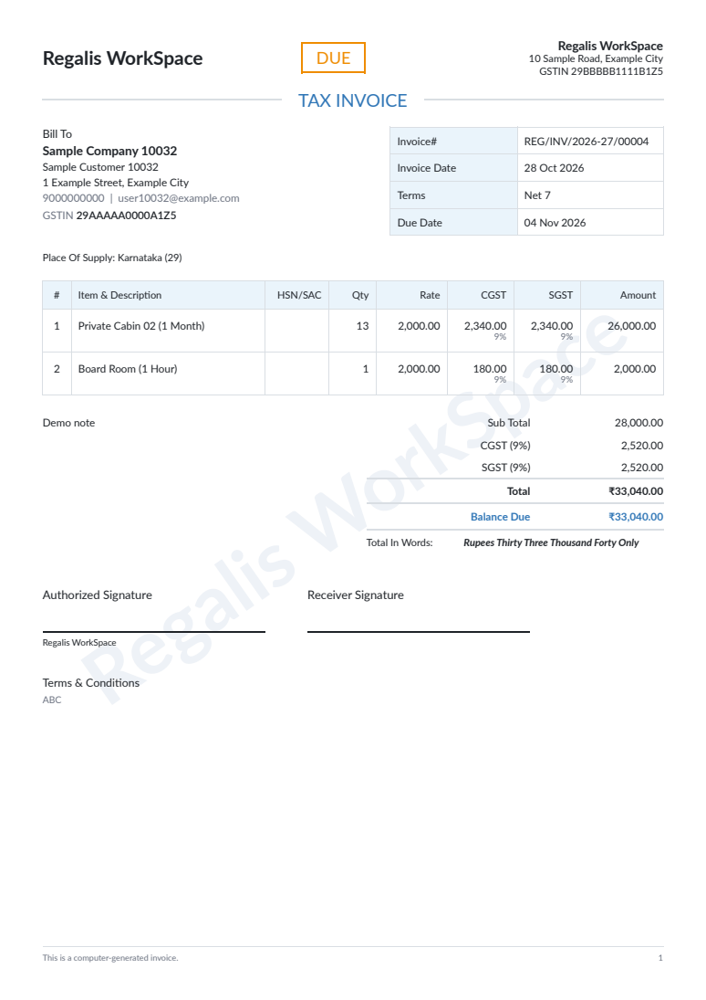

Contents, in order [DC InvoicePdfGenerator.cs]:

1. **Status stamp:** PAID, PARTIALLY PAID, CANCELLED, REFUNDED, or **"DUE" for Pending and Sent** (:480-489).
2. **Header:** logo (or the company name); company name, address and "GSTIN …" only if set (:81-92).
3. **"TAX INVOICE"** (:100).
4. **Bill To:** company (bold) and name, address, "mobile | email", GSTIN if any (:115-140).
5. **Facts:** Invoice#, Invoice Date, Terms ("Net N" or "Due on Receipt"), Due Date, Paid On (:152-160).
6. **Place of supply** (:164-166).
7. **Lines:** # | Item & Description | HSN/SAC | Qty | Rate | CGST and SGST (each shown as half the line tax, with half the rate) or IGST | Amount (pre-tax) (:170-232).
8. **Note:** the invoice notes, else "Thank you for the payment." / "Thank you for your business." (:238).
9. **Totals:** Sub Total, Discount, CGST, SGST, IGST, TDS (negative), Adjustment, Round Off, **Total**, Payment Made, **Balance Due** (:242-296).
10. **Total in words** (Indian numbering) (:300-301).
11. **Bank details:** only if `Company.BankAccountNumber` is set, which it is not in production (:307-330).
12. **Signatures:** "Authorized Signature" and "Receiver Signature" lines.
13. **Terms & Conditions:** the invoice's own (from a quotation), else the global setting.
14. **Watermark and footer:** "Regalis WorkSpace" watermark; "This is a computer-generated invoice." and the page number.

### 6.2 Payment receipt — `GET /api/payments/{id}/receipt` (PAYMENT.VIEW)

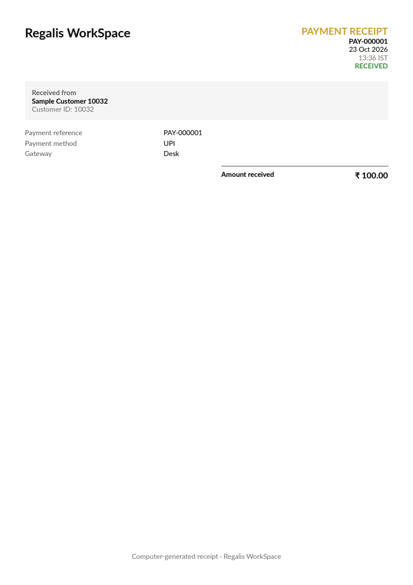

- Only for status Success; otherwise "A receipt exists only for a successful payment."
- **It has no number of its own:** the payment number is the receipt reference [DC ReceiptPdfGenerator :12-15].
- **Contents:**
  - company header; "PAYMENT RECEIPT", payment number, date and time IST, "RECEIVED";
  - "Received from" (the customer's *current* name) and customer ID;
  - payment reference, invoice and invoice total (when linked), "Outstanding after this payment", method, gateway, transaction id;
  - "Amount received"; footer "Computer-generated receipt".
- **"Outstanding after this payment" prints the invoice's outstanding today, not at the time of the payment** [DC ReceiptPdfGenerator :93; PaymentService :310].
- The receipt shows no GST breakdown.

### 6.3 Quotation — `GET /api/quotations/{id}/pdf` (QUOTATION.PRINT)

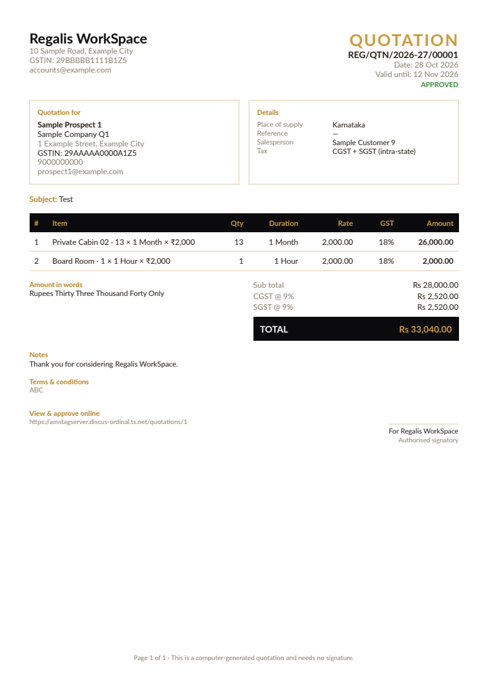

Contents [DC QuotationPdfGenerator.cs]:
- **Header:** company name, address, GSTIN (if set), phone · email.
- **Title block:** "QUOTATION", number, date, valid until, and a status stamp: DRAFT, AWAITING APPROVAL, APPROVED, REJECTED, EXPIRED, REPLACED or CANCELLED (:366-381).
- **"Quotation for":** name, company, address, GSTIN, mobile, email.
- **Details:** place of supply, reference, salesperson, tax mode.
- **Subject.**
- **Lines:** Item (with "qty × term × rate"), Qty, Duration, Rate, GST % or "Non-Taxable", Amount (before the quote-discount share).
- **Totals:** Amount in words; Sub total, Discount, CGST @ x% and SGST @ x% (or IGST), TDS, Adjustment, Round off, TOTAL.
- **Closing:** Notes, Terms, "View & approve online" with the portal link, "For {company} / Authorised signatory".

Behaviour:
- **There is no "Taxable value" row** on the PDF.
- With mixed GST rates the header percentages are stored as 0, so the PDF prints **"CGST @ 0%" next to a non-zero amount** [DC QuotationService :894-898; QuotationPdfGenerator :232-237].
- **Frozen at first send.** On first send the PDF is written to disk and its path stored (`TRN_Quotation.PdfPath`). From then on, if that file exists, downloads return the stored file. **Its stamp therefore stays "AWAITING APPROVAL" after the quotation is approved, rejected or cancelled** [DC QuotationService.EnsurePdfAsync :1193-1210, GetQuotationPdfAsync :705-708].
  - The sample above shows "APPROVED" only because the stored file (on the UAT server's disk) does not exist on this PC, so it was regenerated.
- The portal link uses setting `Quotation.PortalBaseUrl`. That is the production address `https://amstagserver.discus-ordinal.ts.net` **in the production backup and in Dev alike** [DB-P, DB-D]. Emails sent from Dev or UAT would therefore link to production.

### 6.4 Purchase order — `GET /api/purchase-orders/{id}/pdf` (PURCHASE.VIEW)

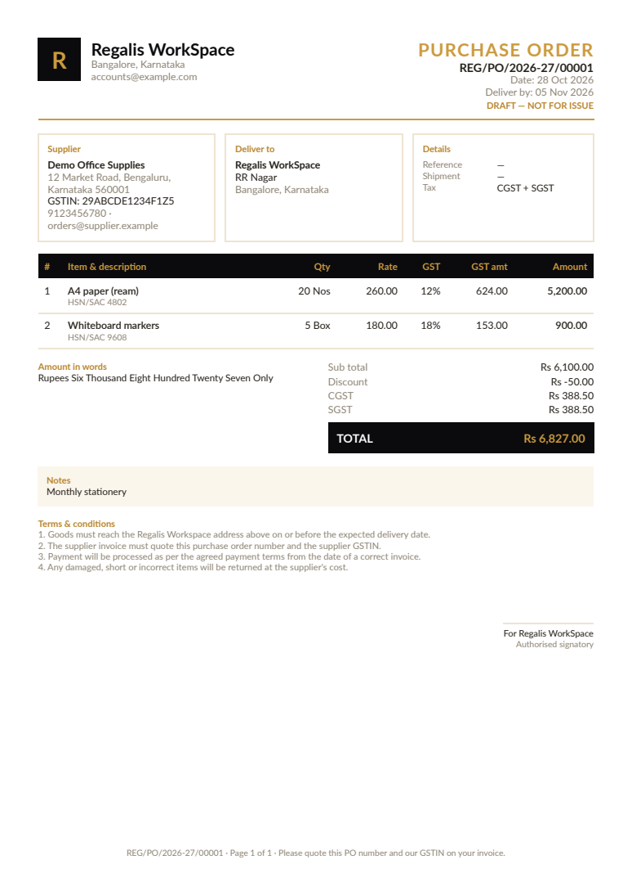

Contents [DC PurchaseOrderPdfGenerator.cs]:
- **Logo:** from `Company.LogoPath`, which is `C:\inetpub\wwwroot\Regalis_Prod\api\brand\regalis-logo.png` in production. If the file is missing, a black "R" tile prints, as on this PC.
- **Header:** company name, address (falls back to the location's), GSTIN if set, phone/email.
- **Title block:** "PURCHASE ORDER", number, date, "Deliver by", and a stamp:
  - Draft: "DRAFT — NOT FOR ISSUE"; Pending: "AWAITING APPROVAL — NOT FOR ISSUE";
  - "APPROVED"; Sent: "ISSUED";
  - "PARTIALLY RECEIVED", "RECEIVED", else "CANCELLED".
- **Blocks:** Supplier, Deliver to, Details (reference, shipment, tax mode, reverse charge).
- **Lines:** # | Item & description (+ HSN/SAC, account) | Qty | Rate | GST % | GST amt | **Amount = qty × rate (ignores discount)** (:228).
- **Totals:** Amount in words; Sub total, Discount, CGST/SGST or IGST (+ "(RCM)"), TDS, Adjustment, TOTAL.
- **Closing:** Notes, Terms, "Approved by", signatory.
- **Footer:** "{PO no} · Page x of y · Please quote this PO number and our GSTIN on your invoice." **But `Company.Gstin` is empty in production**, so the PDF carries no buyer GSTIN.

### 6.5 Wallet statement — `GET /api/admin/wallets/{id}/statement?format=pdf|csv` (WALLET.VIEW)

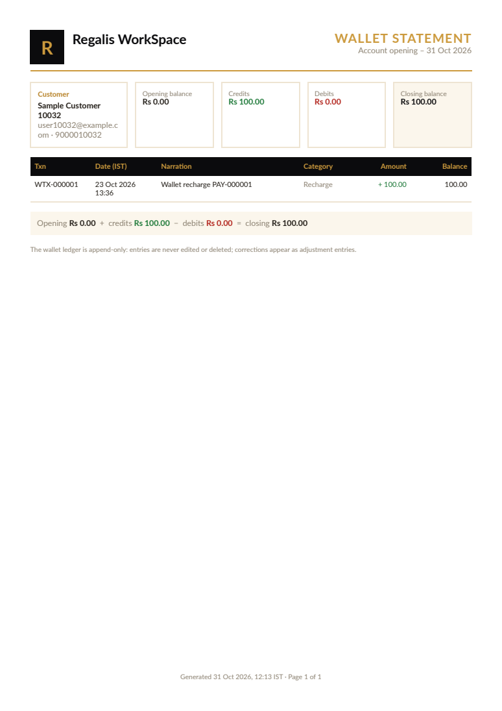

**Contents:** customer, opening balance, credits, debits, closing balance, then the lines (txn, date, narration, category, amount, balance). The footer reads "Opening + credits − debits = closing". Max 20,000 lines. The CSV version has a BOM and the same totals [DC AdminWalletsController; WalletDeskService :256-354].

### 6.6 Exports (CSV)

| Export | Columns | Notes |
|---|---|---|
| Quotations | Quotation, Date, Customer, Company, Reference, Subject, Lines, Sub total, Discount, Taxable, CGST, SGST, IGST, TDS, Round off, Total, Valid until, Status, Invoice | BOM; max 5,000 rows [DC QuotationService :222-256] |
| Expenses | Voucher, Date, Category, Description, Amount, Adjustments, Net Amount, Payment Mode, Remarks, Location, Entered By, Supplier, PO Number, Reconciled | **No formula-injection guard**, no BOM, no row cap [DC ExpenseService :157, :431-439] |
| Bank statement | Date, Bank, Account, Type, Amount, Narration, Reference, Bank reference, Category, Status, Matched to, Remarks | **No formula-injection guard**, no BOM [DC BankService :298-325] |
| Customer wallets | Customer, Email, Mobile, Total incoming, Total spent, Current balance, Low balance, Last activity (IST) | BOM, formula guard, max 10,000 rows |

**Not produced at all:** credit notes, debit notes, invoice export, payment export, supplier statements, GST returns.

---

## 7. Statuses and transitions

### 7.1 Invoice (`InvoiceStatus`: 1 Pending, 2 Paid, 3 PartiallyPaid, 4 Cancelled, 5 Refunded, 6 Sent) [DC Domain InvoiceStatus.cs]

| From | To | How | Source |
|---|---|---|---|
| (new) | Pending or Paid | Created by a booking, extension, pass, quotation or advance (4.3) | [DC InvoiceService, BookingService, PassService] |
| Pending | Sent | "Mark sent". Only from Pending, and it **sends nothing**. | [DC InvoiceService.SendAsync :294-304] |
| Pending / Sent / PartiallyPaid | PartiallyPaid / Paid | Online invoice payment, or a cash collection | [DC PaymentService :247-265; CashCollectionService] |
| Paid / PartiallyPaid | PartiallyPaid / Pending | A cash receipt is voided | [DC CashCollectionService.ApplyToInvoice] |
| any not Cancelled, with **paid = 0** | Cancelled | "Cancel" (reason required); cancelling a pay-later booking or pass; the pay-later sweeper | [DC InvoiceService.CancelAsync :306-325; BookingMutationService :96-103; PassService :452-459; PayLaterSweeper :122-126] |
| — | **Refunded** | **Never assigned anywhere.** Booking and pass refunds go to the wallet and the invoice stays Paid. | grep `InvoiceStatus.Refunded` in [DC]: only read in reports |

The Status filter offers "Refunded" although no invoice can reach it.

### 7.2 Quotation (1 Draft, 2 Sent, 3 Viewed, 4 Approved, 5 Rejected, 6 Expired, 7 Cancelled, 8 Revised)

Source: [DC QuotationService]. History is kept in `TRN_QuotationStatusHistory`, and every event in `TRN_QuotationEvent`.

| From | To | How |
|---|---|---|
| (new) | Draft | Create, Clone (from **any** status), or Revise (creates the new draft) |
| Draft | Sent | Send (:371-485). Valid-until must not be past; at least one line > 0. The first send snapshots customer, company and place of supply, and freezes the PDF. **It succeeds even when nothing was delivered** (see below). |
| Sent | Viewed | Only when the **customer** opens it in their portal (:282-291) |
| Sent / Viewed | Approved / Rejected | Customer portal approve/reject (QUOTATION.APPROVE), or staff "record decision on behalf" (QUOTATION.EDIT) (:727-780). Not after expiry; not if a newer revision exists. |
| Sent / Viewed | Expired | Background sweep **every 60 seconds** once valid-until has passed (BookingHoldSweeper :28, :99-140). The page treats it as expired immediately. |
| Sent / Viewed / Rejected / Expired | Revised | Revise (:487-518). **The original becomes Revised as soon as the revision draft is created**, before anything is sent. |
| any except Cancelled, not invoiced | Cancelled | Cancel, reason required (:571-592) |
| Approved | Approved, with an invoice | Convert to invoice. The status does not change; `InvoiceId` is set. |

**What "Sent" means.** With no SMTP host configured, email "succeeds" with "No mail server is configured — email was not sent." With no WhatsApp API configured, WhatsApp "succeeds" with a manual `wa.me` link that the page never opens. Either result marks the quotation **Sent** [DC QuotationDispatcher.SendEmailAsync, SendWhatsAppAsync].

The repo's `api/appsettings.json` has an empty SMTP host. **Production's SMTP setting is NOT CONFIRMED**: it lives in the server's web.config, which is not readable from here, and the production scripts set no `Smtp__` variables. When a WhatsApp API *is* configured, the PDF is never attached.

**Buttons offered** are decided by the server [DC QuotationService.ActionsFor :1577-1604]:

| Button | Offered when |
|---|---|
| Edit | Draft, QUOTATION.EDIT |
| Send / Resend | Draft / Sent / Viewed, not expired, QUOTATION.EDIT |
| PDF | QUOTATION.PRINT |
| Copy portal link | Not Draft, not Revised, linked customer |
| Revise | Sent / Viewed / Rejected / Expired, not already revised, QUOTATION.CREATE |
| Clone | QUOTATION.CREATE |
| Mark approved / rejected | Sent / Viewed, not expired, not revised, QUOTATION.EDIT |
| Convert to invoice | Approved, no invoice yet, linked customer, **INVOICE.CREATE** |
| Delete | Draft, QUOTATION.DELETE |
| Cancel | Draft / Sent / Viewed / Expired, not invoiced, QUOTATION.DELETE |

**The Cancel API also accepts Approved, Rejected and Revised quotations**; only the buttons hide it.

### 7.3 Purchase order (1 Draft, 2 Sent, 3 PartiallyReceived, 4 Received, 5 Cancelled, 6 PendingApproval, 7 Approved)

Source: [DC PurchaseOrderService]

| From | To | How | Rule |
|---|---|---|---|
| (new) | Draft | Create | :128-149 |
| Draft | PendingApproval | Submit | Needs expected delivery, delivery address, terms and ≥ 1 line. **The API allows it even when approval is off.** (:189-203) |
| Draft | Approved | Approve | Only when `Purchase.RequireApproval` is false. **It is true in production.** (:211-217) |
| PendingApproval | Approved | Approve | Sets the approver. **The approver may be the person who raised it** (no check, :205-239). |
| PendingApproval | Draft | Reject | Reason required (:241-258) |
| Approved | Sent | Send | **Status change only**; nothing goes to the supplier (:260-273) |
| Sent / PartiallyReceived | PartiallyReceived / Received | Receive | Received when every line is fully received (:275-394) |
| any except Cancelled, nothing received | Cancelled | Cancel | Reason required. **Allowed after the PO was sent.** (:396-419) |
| Received / PartiallyReceived | PartiallyReceived / Sent | Reversing a goods receipt in the Assets module | Moves the PO **backwards**, after which it can be cancelled [DC AssetService :3140-3150; AssetOperations.RefreshPurchaseOrderStatusAsync :418-445] |

Each step writes `TRN_PurchaseOrderStatusHistory` and an audit row: `PO_CREATED`, `PO_EDITED`, `PO_SUBMITTED`, `PO_APPROVED`, `PO_REJECTED`, `PO_SENT`, `PO_RECEIVED`, `PO_PARTIALLY_RECEIVED` or `PO_CANCELLED` (:686-729). The Assets reversal writes history but no audit row.

### 7.4 Payment (1 Pending, 2 Success, 3 Failed, 4 Refunded, 5 Cancelled)

| From | To | How |
|---|---|---|
| (new) | Pending | Gateway order created |
| (new) | Success | Desk wallet top-up; cash collection |
| Pending | Success | Browser verify call, or gateway webhook |
| Pending | Failed | Bad signature, or amount over the outstanding |
| Success | Cancelled | Cash receipt voided |
| — | **Refunded** | **Never assigned.** `RefundedAmount` and `RefundReference` are never written. |

**Every gateway payment is recorded as method UPI**, whatever the customer actually used [DC PaymentService.cs:99, :196].

### 7.5 Bank line (1 Unreconciled, 2 Matched, 3 Reconciled)

| From | To | How |
|---|---|---|
| Unreconciled | Matched | Match |
| Matched | Matched | Match again to a different record |
| Matched | Reconciled | Reconcile (BANK.RECONCILE) |
| Matched / Reconciled | Unreconciled | Unmatch (BANK.EDIT) |

Source: [DC BankService :220-296]

### 7.6 Expense and adjustment

An expense has no status field. It is either **live** or **soft-deleted**. While a bank line is matched to it, it cannot be edited or deleted, but it can still be adjusted [DC ExpenseService.GuardNotReconciledAsync :395-401].

---

## 8. Permissions

### 8.1 How permissions work

- **API.** `[HasPermission("X")]` succeeds **only if the user's token carries the claim `perm = X`** [DC PermissionAuthorizationHandler.cs].
  - **There is no superuser bypass.** Administrator works because it holds every code.
  - Claims are written into the token at login from `MAP_RolePermission` [DC AuthService.ResolveAccess :592-604]. **A permission change takes effect at the user's next login or token refresh.**
- **`[StaffOnly]`** additionally refuses customer tokens on some controllers (Admin wallets, Cash, staff quotation reads, invoice terms).
- **Frontend.** Pages and buttons check `permissions.includes(code)`. The sidebar comes from `MAP_RoleMenu`. **The two are not linked** (section 2).

### 8.2 Who holds what in production [DB-P MAP_RolePermission; identical in Dev except the cash codes]

| Permission | Customer | Administrator | Operations Manager | Finance | Support Executive | Housekeeping Staff |
|---|:-:|:-:|:-:|:-:|:-:|:-:|
| INVOICE.VIEW | ✔ | ✔ | ✔ | ✔ | ✔ | ✔ |
| INVOICE.PRINT | ✔ | ✔ | ✔ | ✔ | | |
| INVOICE.CREATE / EDIT / EXPORT | | ✔ | | ✔ | | |
| PAYMENT.VIEW | ✔ | ✔ | ✔ | ✔ | ✔ | ✔ |
| PAYMENT.CREATE | ✔ | ✔ | | ✔ | | |
| PAYMENT.EXPORT | | ✔ | | ✔ | | |
| WALLET.VIEW | ✔ | ✔ | ✔ | ✔ | ✔ | ✔ |
| WALLET.CREATE | ✔ | ✔ | | ✔ | | |
| WALLET.EDIT / EXPORT | | ✔ | | ✔ | | |
| QUOTATION.VIEW | ✔ | ✔ | ✔ | ✔ | ✔ | |
| QUOTATION.PRINT | ✔ | ✔ | ✔ | ✔ | | |
| QUOTATION.CREATE / EDIT / DELETE / EXPORT | | ✔ | ✔ | ✔ | | |
| QUOTATION.APPROVE | ✔ | ✔ | | | | |
| EXPENSE.VIEW / CREATE / EXPORT | | ✔ | ✔ | ✔ | | |
| EXPENSE.EDIT / DELETE | | ✔ | | ✔ | | |
| PURCHASE.VIEW | | ✔ | ✔ | ✔ | | ✔ |
| PURCHASE.CREATE / EDIT / APPROVE / DELETE / EXPORT | | ✔ | ✔ | ✔ | | |
| SUPPLIER.VIEW / CREATE / EDIT | | ✔ | ✔ | ✔ | | ✔ |
| SUPPLIER.DELETE | | ✔ | ✔ | ✔ | | |
| BANK.VIEW / EXPORT | | ✔ | ✔ | ✔ | | |
| BANK.CREATE / EDIT / DELETE / RECONCILE | | ✔ | | ✔ | | |

Customers cannot sign in to the admin portal [DC AuthService.PortalAccepts :42-47]. Their codes serve the customer pages.

**Codes granted but used by no endpoint:** WALLET.EXPORT, INVOICE.EXPORT, PAYMENT.EXPORT, PURCHASE.EXPORT. Wallet exports check WALLET.VIEW, and the others have no export endpoint at all.

### 8.3 Pages a role can open by URL although its sidebar hides them

This is a **real access gap**, verified live for two of the roles [LIVE: test users in the throwaway database; every call below returned 200].

| Role | Opens by URL | What it sees or can do | Verified |
|---|---|---|---|
| Operations Manager | Invoices, Payments, Wallet (list and each customer's ledger), Bank Accounts, Transactions, **Reconciliation** | Every customer's invoices, payments, wallet ledger and contact details; bank balances; export the bank statement | **Yes**: Reconciliation, Bank Accounts, Invoices, a customer wallet |
| Support Executive | Invoices, Payments, Wallet, Quotations | Read every customer's invoices, payments, wallets and quotations | From code and DB |
| Housekeeping Staff | Invoices, Payments, Wallet, Purchase Orders, Suppliers | Read all of these, and **create and edit suppliers** | **Yes**: Suppliers, Wallet, Invoices, Purchase Orders. Expenses correctly went to `/forbidden`. |

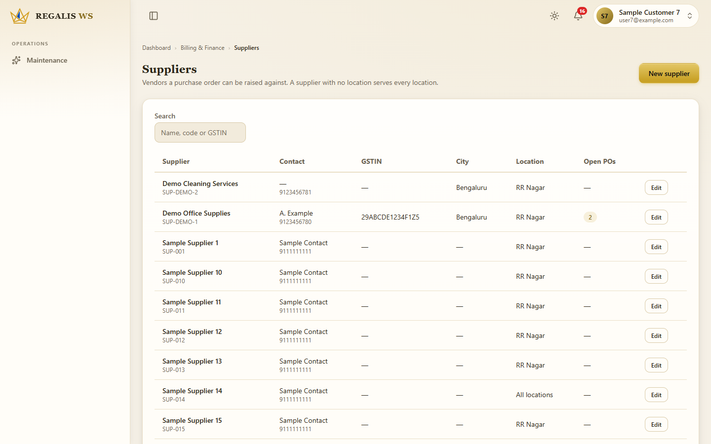

### 8.4 Other permission oddities

- **Invoices:** the "PDF" button shows for everyone on the page, but needs INVOICE.PRINT. Support and Housekeeping get a 403.
- **Purchase orders:**
  - "Send" needs **PURCHASE.APPROVE**, not EDIT.
  - Removing a PO attachment needs CREATE.
  - The PO PDF needs only VIEW.
- **Expenses:** adjustments need EXPENSE.EDIT to create, so **an Operations Manager can record an expense but cannot adjust it**.
- **Quotations:**
  - **An Operations Manager can create, send and approve-on-behalf a quotation but cannot convert it to an invoice** (needs INVOICE.CREATE).
  - Administrators hold QUOTATION.APPROVE, so an admin can call the customer's `/approve` endpoint directly. **That is recorded exactly like the customer's own portal approval** [DC QuotationService :752-764].
  - When staff record a decision "on behalf", `RespondedByUserId` is set to the **customer's** id, not the staff member's [DC :752].
- **Bank:** unmatching a Reconciled line needs only BANK.EDIT.
- **Wallets:** wallet exports and statements need only WALLET.VIEW, which all six roles hold.

---

## 9. The data model

The schema below is production's, read from the backup [DB-P]. Every table also has `CreatedBy, CreatedDate, ModifiedBy, ModifiedDate, IsActive, IsDeleted, DeletedBy, DeletedDate`. **Deletes are soft**: an interceptor turns a delete into `IsDeleted=1` [DC AuditSaveChangesInterceptor :166-178], and a global query filter hides deleted rows [DC RegalisDbContext :211-212].

| Table | Key columns | Read / written by |
|---|---|---|
| `TRN_Invoice` | InvoiceId; **InvoiceNumber** nvarchar(40) unique; CustomerId; BookingId?; CustomerPassId?; QuotationId? (unique when set); LocationId; InvoiceDate; DueDate; SubTotal; DiscountAmount; TaxableAmount; Cgst/Sgst/Igst Percent and Amount; Tds Label/Percent/Amount; Adjustment Label/Amount; RoundOffAmount; **TotalAmount; PaidAmount; OutstandingAmount (computed)**; Status tinyint; PaymentId?; PaidUtc; snapshot of customer (name, email, mobile, GSTIN, company, billing address) and company (name, GSTIN, address); Notes; TermsAndConditions(2000); CancellationReason; ServiceOrderId and PdfPath (**never written**) | Invoices page; created by bookings, passes, quotations |
| `TRN_InvoiceLine` | InvoiceLineId; InvoiceId; LineNumber; Description(300); HsnSacCode(20); Quantity(18,3); UnitPrice; LineAmount; TaxPercent; TaxAmount; TotalAmount | Invoice PDF |
| `TRN_Payment` | PaymentId; **PaymentNumber** unique; CustomerId; BookingId?; InvoiceId?; CustomerPassId?; Amount; PaymentMethod; Gateway; GatewayOrderId; GatewayPaymentId (unique when set); GatewaySignature; IsSignatureVerified; Status; PaidUtc; FailureReason; RefundedAmount and RefundReference (never written); RawGatewayResponse | Payments page, receipts, bank matching |
| `MST_Wallet` | WalletId; CustomerId unique; Balance (≥ 0); TotalCredited; TotalDebited; LastTransactionUtc | Wallet pages |
| `TRN_WalletTransaction` | WalletTransactionId; TransactionNumber unique; WalletId; CustomerId; Direction; Category; Amount; BalanceAfter; ReferenceType/Id; PaymentId; Narration(300); TransactionUtc; PerformedByUserId | Wallet ledger |
| `TRN_Quotation` | QuotationId; **QuotationNumber** unique; CustomerId?; LocationId; QuotationDate; ValidUntil; RevisionOfQuotationId; RevisionNumber; ReferenceNumber; Subject; SalespersonId; money columns as on the invoice plus DiscountType/Value and TaxMode; Status; Sent/Viewed/Responded/Expired Utc; RespondedByUserId; Rejection Reason/Code; Decision OnBehalf/Mode/ConfirmedBy/Note/IpAddress; InvoiceId; Advance Enabled/Type/Value; customer and company snapshot; PlaceOfSupply(+StateCode); Terms(2000); Remarks; InternalNote; **PdfPath** | Quotation pages |
| `TRN_QuotationLine` | LineNumber; LineType; ServiceType; WorkspaceId / PassPlanId / ServiceItemId; Description; LineNotes; HsnSacCode; Quantity; DurationValue; DurationUnit; UnitPrice; StandardRate; DiscountAmount; DiscountShare; LineAmount; TaxableAmount; TaxPercent; IsNonTaxable; TaxAmount; Cgst/Sgst/IgstAmount; TotalAmount | |
| `TRN_QuotationStatusHistory`, `TRN_QuotationEvent`, `TRN_QuotationAttachment` | Status changes (from, to, by, when, reason); events (type, actor, summary, channel, destination, delivery status); files (name, path, type, size, send-with-email) | Detail page activity and attachments |
| `TRN_PurchaseOrder` | PurchaseOrderId; **PoNumber** unique; PoDate; SupplierId; LocationId; ExpectedDeliveryDate; money columns plus TaxAmount; Status; IsInterState; IsReverseCharge; Submitted/Approved/Sent/Cancelled Utc; ApprovedByUserId; CancellationReason; ReferenceNumber; ShipmentPreference; DeliveryAddress; Terms(4000); AttachmentPath (legacy, unused) | PO pages |
| `TRN_PurchaseOrderLine` | PurchaseOrderId; LineNumber; InventoryItemId?; ItemName(300); HsnSacCode; Unit; AccountCategory; Quantity; **ReceivedQuantity**; Rate; DiscountAmount; LineAmount; TaxPercent; TaxAmount; Cgst/Sgst/IgstAmount; TotalAmount | |
| `TRN_PurchaseOrderStatusHistory`, `TRN_PurchaseOrderAttachment` | History (from, to, action, by, when, reason); files | |
| `MST_Supplier` | SupplierId; **SupplierCode** unique; SupplierName; ContactPerson; Email; MobileNumber; Gstin; AddressLine; City; State; Pincode; PaymentTerms; LocationId?; Notes. **No PAN column.** | Suppliers page |
| `TRN_Expense` | ExpenseId; **ExpenseNumber** unique; ExpenseDate; Category(100); Description; Amount (> 0); PaymentMethod; Remarks (NOT NULL); AttachmentPath; LocationId; EnteredByUserId; SupplierId?; PurchaseOrderId?; **AdjustmentTotal**. **No tax columns.** | Expenses page |
| `TRN_ExpenseAdjustment` | ExpenseId; AdjustmentType (1 Increase, 2 Decrease); Amount (> 0); AdjustmentDate; Reason; Remarks | |
| `MST_BankAccount` | BankAccountId; **AccountCode** unique; BankName; AccountName; AccountNumberMasked(40); Ifsc; Branch; AccountType; OpeningBalance; OpeningBalanceAsOn; LocationId?; Notes | Bank Accounts |
| `TRN_BankTransaction` | BankTransactionId; BankAccountId; TransactionDate; Direction (1 credit, 2 debit); Amount (> 0); Narration; ReferenceNumber; BankReferenceId (unique per account); Category; ReconciliationStatus; MatchedPaymentId / MatchedExpenseId (each unique, only one set); Matched/Reconciled Utc and ByUserId; LocationId (NOT NULL); EnteredByUserId; **ImportBatchId (never written)**; Remarks | Transactions, Reconciliation |
| `MST_NumberSequence` | SequenceKey; Prefix; CurrentValue; **FinancialYear (text)** | All numbering |
| `MST_AppSetting` | SettingKey; SettingValue | Tax, Company, Invoice, Quotation, Purchase, Wallet settings |
| `MST_Menu`, `MAP_RoleMenu`, `MST_Permission`, `MAP_RolePermission` | Sidebar and permissions | Section 8 |
| Also written | `TRN_AuditLog`, notification tables; `TRN_GoodsReceipt(+Line)` and inventory tables on PO receive (owned by Assets) | |

**Unique indexes not filtered on `IsDeleted`:** `UX_Supplier_Code`, `UX_BankAccount_Code` and `UX_BankTxn_Account_BankReference`. The services check uniqueness only among *live* rows. So reusing the code of a deleted supplier or bank account, or the bank reference of a deleted line, passes the service check and then fails at the database. The API turns that into a generic **500 "An unexpected error occurred"** [DC ExceptionHandlingMiddleware.cs:29]. This was worked out from the code and the indexes; I did not run it.

**Production versus Dev schema, for these tables.** Column-by-column comparison of 28 tables found:
- **Only in Dev:** `TRN_CashCollection`, `TRN_CashRegisterSession`, `TRN_GoodsReceipt`, `TRN_GoodsReceiptLine`; columns `MST_User.PayLaterAllowed` and `TRN_Booking.IsPayLater, AmountPaid, PaymentDueUtc, PayLaterReminderSentUtc`; the `PayLater.*` and `Wallet.DeskAddMoneyEnabled` settings; the `CashReceipt` and `CashSession` sequences.
- **Only in production:** nothing.
- **Type or nullability differences:** none.

---

## 10. The API

All responses use the envelope `{ data, success, message, errors[], correlationId }`. Lists return `{ items, page, pageSize, totalCount, totalPages, hasNext, hasPrevious }` [DC Shared PagedResult]: `pageSize` defaults to 20 and is capped at 100, and lists also accept `Search`. Permission and `[StaffOnly]` are from the decompiled controllers. The line is where the attribute sits in the decompiled file. Paths and query parameters are from swagger.

### 10.1 Invoices — [DC InvoicesController]

| Method and path | Permission | Takes | Returns | Line |
|---|---|---|---|---|
| GET `/api/invoices/terms` | INVOICE.VIEW, StaffOnly | — | `{termsAndConditions}` | 25 |
| PUT `/api/invoices/terms` | INVOICE.EDIT, StaffOnly | `{termsAndConditions}` ≤ 4000 | same | 34 |
| GET `/api/invoices` | INVOICE.VIEW | Status, Overdue, CustomerId, From, To, paging, Search | page of InvoiceDto. A customer token gets only its own invoices, and other filters are ignored. | 48 |
| GET `/api/invoices/{id}` | INVOICE.VIEW | — | InvoiceDto | 64 |
| GET `/api/invoices/my` | INVOICE.VIEW | Status "pending" / "paid", paging | the caller's invoices. **"pending" = Pending or PartiallyPaid only; Sent invoices are left out** [DC InvoiceService :40-43]. | 73 |
| GET `/api/invoices/{id}/pdf` | INVOICE.PRINT | — | PDF | 82 |
| POST `/api/invoices/from-quotation/{quotationId}` | INVOICE.CREATE | — | 201 InvoiceDto | 96 |
| POST `/api/invoices/{id}/send` | INVOICE.EDIT | — | InvoiceDto | 106 |
| POST `/api/invoices/{id}/cancel` | INVOICE.EDIT | `{reason}` | InvoiceDto | 116 |

`InvoiceDto` fields: InvoiceId, InvoiceNumber, CustomerId, BookingId, QuotationId, QuotationNumber, InvoiceDate, DueDate, SubTotal, DiscountAmount, TaxableAmount, Cgst/Sgst/Igst Percent and Amount, TotalAmount, PaidAmount, OutstandingAmount, Status, IsOverdue, PaidUtc, CancellationReason, TermsAndConditions, CustomerName, CustomerEmail, CompanyName, CompanyGstin, Lines[] (LineNumber, Description, HsnSacCode, Quantity, UnitPrice, LineAmount, TaxPercent, TaxAmount, TotalAmount).

It does not carry: pass id, TDS, adjustment, round-off, customer GSTIN, mobile, company or address.

### 10.2 Payments — [DC PaymentsController]

| Method and path | Permission | Takes | Returns | Line |
|---|---|---|---|---|
| GET `/api/payments` | PAYMENT.VIEW | Status, PaymentMethod, CustomerId, paging, Search | page of PaymentDto (a customer is forced to their own) | 22 |
| GET `/api/payments/{id}` | PAYMENT.VIEW | — | PaymentDto | 34 |
| POST `/api/payments/order` | PAYMENT.CREATE | `{bookingId}` | `{paymentId, paymentNumber, gatewayOrderId, keyId, amount, currency, provider}` | 44 |
| POST `/api/payments/sandbox-complete` | PAYMENT.CREATE | `{gatewayOrderId}` | `{gatewayPaymentId, gatewaySignature}` (sandbox provider only) | 53 |
| POST `/api/payments/webhook` | **anonymous**, rate-limited, Razorpay signature header | raw body | "Acknowledged." | 62 |
| POST `/api/payments/invoice-order` | PAYMENT.CREATE | `{invoiceId, amount?}` | order as above | 75 |
| POST `/api/payments/invoice-verify` | PAYMENT.CREATE | `{gatewayOrderId, gatewayPaymentId, gatewaySignature}` | `{payment, invoiceId, invoiceNumber, paidAmount, outstandingAmount, invoiceStatus}` | 85 |
| GET `/api/payments/{id}/receipt` | PAYMENT.VIEW | — | PDF | 95 |

`PaymentDto` fields: PaymentId, PaymentNumber, CustomerId, CustomerName, BookingId, InvoiceId, InvoiceNumber, InvoiceAmount, CustomerPassId, Amount, PaymentMethod, Gateway, GatewayOrderId, GatewayPaymentId, RefundedAmount, RefundReference, IsSignatureVerified, Status, PaidUtc, FailureReason, CreatedDate.

### 10.3 Wallets — [DC AdminWalletsController, WalletController]

| Method and path | Permission | Takes | Returns | Line |
|---|---|---|---|---|
| GET `/api/admin/wallets` | WALLET.VIEW, StaffOnly | Filter, Sort, Activity, Search, paging | `{wallets: page of {customerId, fullName, email, mobileNumber, totalCredit, totalDebit, balance, lastActivityUtc, isLowBalance}, summary: {balanceHeld, totalRecharged, totalSpent, customerCount, lowBalanceCount, lowBalanceThreshold}, filteredTotals}` | 23 |
| GET `/api/admin/wallets/export` | WALLET.VIEW, StaffOnly | same filters | CSV | 32 |
| GET `/api/admin/wallets/{customerId}` | WALLET.VIEW, StaffOnly | Direction, Category, From, To, Search, paging | `{customer, totalCredit, totalDebit, balance, isLowBalance, lowBalanceThreshold, ledgerVerified, transactions (page of ledger rows), nextPaymentNumber}` | 42 |
| GET `/api/admin/wallets/{customerId}/statement` | WALLET.VIEW, StaffOnly | from, to, format = pdf / csv | file | 51 |
| POST `/api/admin/wallets/{customerId}/add-money` | WALLET.EDIT, StaffOnly | `{amount, paymentMethod, reference?, receivedOn, narration?, notifyCustomer, expectedPaymentNumber?}` | `{paymentNumber, paymentId, transactionNumber, balance, notificationNote}` | 62 |
| POST `/api/admin/wallets/{customerId}/adjust` | WALLET.EDIT, StaffOnly | `{direction "credit"/"debit", amount, reason, narration}` | wallet detail | 71 |
| GET `/api/wallet/{customerId}` | WALLET.VIEW, StaffOnly | — | balance counters | 54 |
| GET `/api/wallet/{customerId}/transactions` | WALLET.VIEW, StaffOnly | Month, Category, paging | ledger | 63 |
| POST `/api/wallet/{customerId}/adjust` (**older endpoint**) | WALLET.EDIT, StaffOnly | `{direction, amount, reason}` | wallet | 73 |

The older adjust endpoint has **no upper limit and no separate audit entry**, and the reason becomes customer-visible narration [DC WalletAdminService.AdjustAsync :118-154]. No routed page calls it, but it is reachable.

`/api/wallet/me…` and `/api/wallet/recharge…` serve the customer portal and are out of scope.

### 10.4 Quotations — [DC QuotationsController]

| Method and path | Permission | Line |
|---|---|---|
| GET `/api/quotations` (Status, CustomerId, LocationId, ServiceType, From, To, DatePreset, ExpiringInDays, SortBy date / number / amount, paging, Search) | QUOTATION.VIEW, StaffOnly | 66 |
| GET `/api/quotations/status-counts` (same query) → `{totalCount, statusCounts}` | QUOTATION.VIEW, StaffOnly | 88 |
| GET `/api/quotations/summary` → FY totals | QUOTATION.VIEW, StaffOnly | 98 |
| GET `/api/quotations/item-rates?inventoryItemId&take` (**unused by the page**) | QUOTATION.VIEW, StaffOnly | 77 |
| GET `/api/quotations/form-options` → next number, defaults, GST options, TDS options, services catalogue, states | QUOTATION.CREATE, StaffOnly | 108 |
| GET `/api/quotations/export` → CSV | QUOTATION.EXPORT, StaffOnly | 118 |
| GET `/api/quotations/{id}` → QuotationDto | QUOTATION.VIEW, StaffOnly | 127 |
| POST `/api/quotations` (SaveQuotationRequest) → 201 | QUOTATION.CREATE | 135 |
| PUT `/api/quotations/{id}` (Draft only) | QUOTATION.EDIT | 145 |
| DELETE `/api/quotations/{id}` (Draft only, soft) | QUOTATION.DELETE | 154 |
| POST `/{id}/send` `{sendEmail, sendWhatsApp, emailTo, emailCc, bccMe, emailSubject, emailMessage, whatsAppTo, whatsAppMessage}` | QUOTATION.EDIT | 165 |
| POST `/{id}/revise` `{reason}` and `/{id}/clone` | QUOTATION.CREATE | 174, 183 |
| POST `/{id}/record-decision` `{approved, mode, confirmedBy, note, reasonCode}` | QUOTATION.EDIT | 194 |
| POST `/{id}/cancel` `{reason}` | QUOTATION.DELETE | 202 |
| PUT `/{id}/internal-note` `{note}` (**no page calls it**) | QUOTATION.EDIT | 211 |
| POST / PATCH / DELETE `/{id}/attachments…` | QUOTATION.EDIT | 222–244 |
| GET `/{id}/attachments/{aid}` | QUOTATION.VIEW | 253 |
| GET `/{id}/pdf` | QUOTATION.PRINT | 264 |
| GET `/api/quotations/my`, `/my/{id}`; POST `/{id}/approve`, `/{id}/reject` `{reasonCode, reason, acceptedTerms}` (customer portal) | QUOTATION.VIEW / QUOTATION.APPROVE | 32–57 |

`SaveQuotationRequest`:
- Header: customerId, locationId, quotationDate, validUntil, referenceNumber, subject, salespersonId, placeOfSupplyStateCode, discountType, discountValue, tdsCode, adjustmentLabel, adjustmentAmount, advanceInvoiceEnabled, advanceType, advanceValue, termsAndConditions, remarks, internalNote, customerName, billingAddress, customerGstin.
- `lines[]`: lineType, serviceType, workspaceTypeId, serviceItemId, workspaceId, passPlanId, description, lineNotes, hsnSacCode, quantity, durationValue, durationUnit, unitPrice, standardRate, discountAmount, taxPercent, inventoryItemId, itemType, unit, isNonTaxable.

`QuotationDto` returns every stored header field plus: lines, statusHistory, attachments, events, isExpired, daysToExpiry, totalInWords, revision and replacement links, invoiceNumber, and `actions` (the 10 flags in 7.2).

### 10.5 Expenses — [DC ExpensesController] (no StaffOnly)

| Method and path | Permission | Takes → returns | Line |
|---|---|---|---|
| GET `/api/expenses` | EXPENSE.VIEW | Category, PaymentMethod, LocationId, SupplierId, From, To, paging, Search → page of ExpenseDto | 19 |
| GET `/api/expenses/{id}` | EXPENSE.VIEW | → ExpenseDto | 27 |
| GET `/api/expenses/summary` | EXPENSE.VIEW | list filters → `{totalAmount, totalCount, byCategory[{category, amount, count}], grossAmount, adjustmentTotal}` | 36 |
| GET `/api/expenses/categories` | EXPENSE.VIEW | → string[] | 45 |
| POST `/api/expenses` | EXPENSE.CREATE | `{expenseDate?, category, description, amount, paymentMethod, remarks, attachmentPath?, locationId, supplierId?, purchaseOrderId?}` → 201 | 53 |
| PUT `/api/expenses/{id}` | EXPENSE.EDIT | same | 62 |
| DELETE `/api/expenses/{id}` | EXPENSE.DELETE | soft delete | 69 |
| GET `/api/expenses/export` | EXPENSE.EXPORT | list filters → CSV | 78 |
| GET `/api/expenses/monthly` | EXPENSE.VIEW | Year + filters → `{year, totalAmount, months[{month, amount, count}]}` | 89 |
| GET `/api/expenses/adjustments`, `/{adjustmentId}` | EXPENSE.VIEW | ExpenseId, AdjustmentType, Category, From, To, paging | 97, 105 |
| POST / PUT `/api/expenses/adjustments` | **EXPENSE.EDIT** | `{expenseId, adjustmentType, amount, adjustmentDate?, reason, remarks?}` | 113, 122 |
| DELETE `/api/expenses/adjustments/{adjustmentId}` | EXPENSE.DELETE | | 129 |

`ExpenseDto` fields: ExpenseId, ExpenseNumber, ExpenseDate, Category, Description, Amount, PaymentMethod, Remarks, AttachmentPath, LocationId, LocationName, EnteredByUserId, EnteredByName, SupplierId, SupplierName, PurchaseOrderId, PoNumber, BankTransactionId, IsReconciled, CreatedDate, AdjustmentTotal, NetAmount, AdjustmentCount.

### 10.6 Purchase orders — [DC PurchaseOrdersController] (no StaffOnly)

| Method and path | Permission | Line |
|---|---|---|
| GET `/api/purchase-orders` (Status, SupplierId, LocationId, From, To, paging, Search) | PURCHASE.VIEW | 27 |
| GET `/form-options` → next number, RequireApproval, GST options, shipment preferences, account categories, default terms, home state, TDS options, states, max attachments (10) and size (10 MB) | PURCHASE.VIEW | 37 |
| GET `/{id}` → PurchaseOrderDto | PURCHASE.VIEW | 45 |
| POST `/` and PUT `/{id}` (Draft only) | PURCHASE.CREATE / PURCHASE.EDIT | 53, 62 |
| POST `/{id}/submit` | PURCHASE.CREATE | 71 |
| POST `/{id}/approve` `{comment?}`, `/{id}/reject` `{comment}`, `/{id}/send` | PURCHASE.APPROVE | 80, 89, 98 |
| POST `/{id}/receive` `{receivedDate?, purchaseInvoiceNumber?, attachmentPath?, notes?, lines[{purchaseOrderLineId, receivedQuantity}]}` | PURCHASE.EDIT | 108 |
| POST `/{id}/cancel` `{reason}` | PURCHASE.DELETE | 116 |
| POST / DELETE `/{id}/attachments…` | PURCHASE.CREATE | 127, 140 |
| GET `/{id}/attachments/{aid}`, `/{id}/pdf` | PURCHASE.VIEW | 148, 158 |

`SavePurchaseOrderRequest`:
- Header: poDate, supplierId, locationId, expectedDeliveryDate, remarks, referenceNumber, shipmentPreference, isReverseCharge, deliveryAddress, discountType (1 % / 2 ₹), discountValue, tdsCode, adjustmentLabel, adjustmentAmount, termsAndConditions.
- `lines[]`: inventoryItemId, itemName, hsnSacCode, unit, quantity, rate, discountAmount, taxPercent, remarks, accountCategory.

### 10.7 Suppliers — [DC SuppliersController]

| Method and path | Permission | Line |
|---|---|---|
| GET `/api/suppliers` (LocationId, IsActive, paging, Search) → page of SupplierDto, ordered by name | SUPPLIER.VIEW | 17 |
| GET `/api/suppliers/{id}` | SUPPLIER.VIEW | 25 |
| POST `/api/suppliers`, PUT `/{id}` `{supplierCode, supplierName, contactPerson, email, mobileNumber, gstin, addressLine, city, state, pincode, paymentTerms, locationId, notes}` | SUPPLIER.CREATE / SUPPLIER.EDIT | 33, 42 |
| DELETE `/api/suppliers/{id}` | SUPPLIER.DELETE | 49 |

`SupplierDto` adds: SupplierId, LocationName, OpenPurchaseOrders, IsActive.

### 10.8 Bank — [DC BankController] (no StaffOnly)

| Method and path | Permission | Line |
|---|---|---|
| GET `/api/bank/accounts`, `/{id}` → BankAccountDto (with CurrentBalance, TotalCredits, TotalDebits, UnreconciledCount) | BANK.VIEW | 22, 30 |
| POST, PUT `/api/bank/accounts` `{accountCode, bankName, accountName, accountNumberMasked, ifsc?, branch?, accountType?, openingBalance, openingBalanceAsOn?, locationId?, notes?}` | BANK.CREATE / BANK.EDIT | 38, 47 |
| DELETE `/api/bank/accounts/{id}` | BANK.DELETE | 54 |
| GET `/api/bank/transactions` (BankAccountId, Direction, ReconciliationStatus, LocationId, From, To, paging, Search), `/{id}` | BANK.VIEW | 63, 71 |
| POST, PUT `/api/bank/transactions` `{bankAccountId, transactionDate?, direction, amount, narration, referenceNumber?, bankReferenceId?, category?, locationId, remarks?}` | BANK.CREATE / BANK.EDIT | 79, 88 |
| DELETE `/api/bank/transactions/{id}` (Unreconciled only) | BANK.DELETE | 95 |
| GET `/{id}/candidates` → `[{kind, id, number, description, amount, date, amountMatches, alreadyMatched}]` | BANK.VIEW | 105 |
| POST `/{id}/match` `{paymentId? or expenseId?}` (exactly one), `/{id}/unmatch` | BANK.EDIT | 115, 123 |
| POST `/{id}/reconcile` | BANK.RECONCILE | 131 |
| GET `/api/bank/export` | BANK.EXPORT | 139 |

### 10.9 Endpoints used by these pages but owned elsewhere

- `GET /api/locations` (login only).
- `GET /api/customers` (customer pickers).
- `GET /api/admin/goods-receipts/open-purchase-orders` (Assets).

---

## 11. What is NOT built

Each item below was searched for in the decompiled API, the deployed bundles, swagger and the production schema, and nothing was found.

### Invoicing and receivables
- **Manual invoice creation.** The only creators are bookings, extensions, passes, quotations and quotation advances. The controller's own comment promises "Manual invoices … arrive with the finance screens on Day 6"; they never did [DC InvoicesController summary :13-14].
- **Invoice editing.** By design: an issued invoice is never edited, only cancelled.
- **Credit notes and debit notes.** No table, endpoint or PDF exists.
- **Refunds against an invoice or payment.** `InvoiceStatus.Refunded`, `PaymentStatus.Refunded`, `RefundedAmount` and `RefundReference` exist but nothing writes them. Refunds go to the customer wallet.
- **Recording an offline payment against an invoice from the Invoices page.** The only offline route is Cash Collections (section 13), which is not live and covers bookings and passes, not invoices.
- **Sending an invoice.** "Mark sent" is a flag; no email or WhatsApp is sent. There are no customer payment reminders either: only an admin "invoice overdue" alert [DC AdminNotificationJobs :110-140].
- **An invoice detail screen** for staff.
- **Customer statement or ageing report** (debtors by age).
- **Invoice and payment export**, although INVOICE.EXPORT and PAYMENT.EXPORT are granted.
- **A date filter on Payments.**
- **Gateway settlement reconciliation:** matching Razorpay payouts to payments.

### GST and compliance
- **E-invoicing** (IRN / QR code).
- **GSTR-1 / GSTR-3B data.**
- **HSN/SAC on booking and pass invoices**, and an HSN/SAC field on quotations.
- **A place of supply per invoice.**
- **IGST on bookings and passes.**
- **A reverse-charge flag on invoices.**
- **Supplier GSTIN, address and bank details on documents.** The fields exist, but production's settings are empty.
- **Financial-year rollover of document numbers** (5.5).
- **Input tax credit tracking** on expenses or purchases.
- **TDS ledger, challans or certificates.** TDS is only calculated and printed on quotations and POs.

### Purchasing and payables
- **Supplier bills.** A purchase invoice as a record does not exist; the supplier's invoice number is only a text field on a goods receipt.
- **Payables, payments to suppliers, supplier balance and ageing.**
- **Three-way match** of PO, receipt and bill.
- **Emailing a PO to the supplier.** "Send" is a status change.
- **PO amendment after sending; closing a part-received PO short.**
- **An approval threshold, multi-level approval, or a block on approving your own PO.**
- **Supplier deactivation** (the app tells users to do it, but there is no way); supplier PAN, bank and MSME fields; supplier import.

### Expenses
- **GST fields, bill number and an attachment upload** on expenses.
- **A PO picker**, although the API accepts `purchaseOrderId`.
- **A category master.** Categories are free text.
- **An approval workflow and recurring expenses.**
- **Payment-mode, location and supplier filters** in the UI (the API has them).

### Bank
- **Statement import.** The `ImportBatchId` column, the "imported twice" hint and a class comment exist, but there is no endpoint and no upload control.
- **Editing or deleting a bank line from the UI** (API only).
- **Bank account deactivation.**
- **Split or many-to-one matching, amount tolerance, auto-match.**
- **Matching to anything other than a successful payment or an expense:** for example transfers between own accounts, bank charges, interest, or customer refunds.
- **Use of "opening balance as on"; balance as at a date; a bank book.**

### Wallet
- **Withdrawal or payout.** Setting `Wallet.Withdrawable=false` exists, but there is no endpoint.
- **Maker-checker approval** for wallet adjustments and desk top-ups.

### Module-wide
- **A finance dashboard.** The page code ships, but there is no route and its menu row is deleted.
- **A general ledger, chart of accounts, journal, trial balance or profit and loss.** None exists in this module.

---

## 12. Known problems and rough edges

Ordered roughly by how much they matter. Each is code-confirmed unless marked.

### 12.1 Source drift: the source tree you named is not what built the running DLLs

You asked me to compare `C:\Inetpub\wwwroot\Regalis_Prod\api` with `C:\Users\Administrator\Downloads\Regalis`. **I could not.** Neither path exists on this PC (host `santhosh`; there is no `C:\inetpub` and no `Administrator` profile). What I could establish:

1. **The deployed DLLs were built from `Downloads\Regalis-live`, not `Downloads\Regalis`.** The decompiled Infrastructure assembly contains 54 compiler-embedded source paths in its PDF generators. **Every one is `C:\Users\Administrator\Downloads\Regalis-live\backend\src\…`, and none is `Downloads\Regalis\backend`** (InvoicePdfGenerator 18, QuotationPdfGenerator 15, PurchaseOrderPdfGenerator 14, WalletStatementPdfGenerator 6, CashReceiptPdfGenerator 1).
2. **The deploy scripts disagree about the source tree.**
   - 15 `deploy-*.cmd` scripts build from `C:\Users\Administrator\Downloads\Regalis\backend`.
   - The 4 newest build from `…\Downloads\Regalis-live\backend`: `deploy-assets.cmd`, `deploy-pass-upgrade.cmd`, `deploy-reports-analysis.cmd` and `deploy-pay-later.cmd`, dated 23–28 Oct.

   So `Downloads\Regalis` is at best behind for the Assets, Reports, Pass-upgrade and Pay-later changes.
3. **The Dev database and this build disagree.**
   - Dev has migration `20261029030331_CashInvoiceCollections` applied. That migration is **not in `db/migrations/`** and the build has no code for it.
   - Dev lacks `20261028064444_PayLaterPasses`, which **is** in `db/migrations/` and which the build needs.
   - Running this build against Dev logs `Invalid column name 'IsPayLater' / 'AmountPaid' / 'PaymentDueUtc'` every 5 minutes, from the pay-later sweeper [LIVE api.log; DC PayLaterSweeper :36]. Dev is therefore not a faithful test bed for the deployed build.
4. **Production frontend = repo frontend:** confirmed byte for byte (section 0).
5. **Production API = repo API: NOT CONFIRMED.** I tried:
   - the production DLL path (not on this PC);
   - production swagger (disabled, 401);
   - logged-out probes (401 for every path, including made-up ones);
   - the only anonymous endpoint, `/api/settings/public`, which returns support details and cannot tell builds apart.

   The promote script copies API and frontend together (section 0.3), which makes it likely.

**Why it matters.** The next change made in `Downloads\Regalis` and deployed with one of the 15 older scripts would build from a tree that lacks the Assets, Reports, Pass-upgrade and Pay-later code. That would silently remove those features. Someone needs to decide which tree is the source of truth, and diff the two on the server.

### 12.2 Production configuration gaps that affect every document

- **`Company.Gstin`, `Company.Address`, `Company.Phone` and the company bank fields are empty in production** [DB-P]. Every "TAX INVOICE", quotation, PO and receipt is issued without the seller's GSTIN or address. The PO footer still asks the supplier to quote "our GSTIN".
- **Document numbers will not roll to 2027-28** (5.5).
- **`Wallet.DeskAddMoneyEnabled` is absent in production**, so desk top-up defaults to **on**, with no minimum or maximum other than ₹10,00,000 (3.3).

### 12.3 Money and data integrity

1. **Payment webhook race** [DC PaymentService.HandleWebhookAsync :129-161].
   - The gateway webhook marks only the payment row as Success; it never updates the invoice, booking or pass.
   - If the webhook arrives before the browser's verify call, that call fails with "already settled" [DC PaymentService :220-223; BookingService :373-376].
   - Result: the money is taken, but the invoice stays unpaid or the booking unconfirmed.
   - Production `env.js` has online payment switched off, which limits exposure today. Whether the production API is configured for Razorpay is **NOT CONFIRMED** (server config not readable).
2. **Refunded bookings keep a Paid GST invoice**, with no credit note (7.1, 11).
3. **Bank matching ignores amounts entirely.** The "exact amount" hint compares the expense's gross voucher amount, and a matched expense can still be adjusted afterwards. A matched or reconciled line can therefore silently disagree with what it points at (3.10).
4. **Reconciliation hides lines in status Matched by default**, then says "Every line … has been matched and confirmed" (3.10).
5. **An invoice from an inter-state quotation prints the wrong place of supply** (5.3).
6. **A quotation with no place of supply is taxed as intra-state** (4.2).
7. **"CGST @ 0%" with a non-zero amount** on quotations with mixed GST rates (6.3).
8. **Quotation PDFs keep "AWAITING APPROVAL"** after a decision (6.3).
9. **Converting a quotation**:
   - copies text-only header rows as zero-value invoice lines [DC InvoiceService :158-172];
   - drops the per-line discount share, so line amount + tax ≠ line total.
10. **Advance (security deposit) invoices**:
    - are charged 0% GST;
    - are not linked to the quotation (no `QuotationId`);
    - leave "Convert to invoice" still offered on the quotation [DC InvoiceService :207-284].
11. **"Outstanding after this payment" on a receipt shows today's figure**, not the figure at the time of the payment (6.2).
12. **Every gateway payment is labelled UPI** (7.4).
13. **Wallet "Total recharged" includes refunds and adjustments** (3.3).
14. **Expense adjustments are charted in the original expense's month** (3.5).
15. **Booking invoices that were paid at once still show a due date a week later** (4.4).
16. **PO Amount column shows qty × rate ignoring discounts**, on the detail page and the PDF (6.4). **PO totals are rounded to the rupee by default** in the UI (3.6).
17. **Soft-delete versus unique indexes** on supplier code, bank account code and bank reference produce a 500 error instead of a clear message (section 9). Worked out from code and indexes; not run.

### 12.4 Workflow defects

1. **"Sent" when nothing was sent**, for quotations (no mail server or WhatsApp API) and for invoices ("Mark sent" only flips a flag).
2. **Revise, then delete the revision: the original stays "Revised" for ever.** It can then no longer be revised, approved or rejected, and the customer sees "Replaced" with nothing replacing it [DC QuotationService :491, :736; DeleteAsync :359].
3. **The Cancel API accepts Approved, Rejected and Revised quotations**, which the UI never offers.
4. **Admins can approve "as the customer"** through the customer endpoint, indistinguishably. On-behalf decisions record the customer as the responder (8.4).
5. **POs can be cancelled after being sent to the supplier**, and an Assets receipt reversal can move a PO backwards to Sent.
6. **No segregation of duties on POs:** the same person can raise, approve and send.
7. **"Deactivate it instead"** is shown for suppliers and bank accounts, and neither can be deactivated.
8. **The quotation "Awaiting reply" card counts Sent + Viewed**, but clicking it shows only Sent.
9. **"Open invoice" on a quotation goes to the invoice list**, not the invoice.
10. **Quotation attachment links on the detail page send no login token**, so they should fail with 401 (read from code; not exercised).

### 12.5 Access control

1. **Pages hidden from the sidebar are open by URL** to Operations Manager, Support Executive and Housekeeping Staff. That includes every customer's invoices, payments and wallet ledger, and, for Housekeeping, creating and editing suppliers. **Verified live** (8.3).
2. **Reconciliation has no menu entry for anyone** but works by URL for Administrator, Operations Manager and Finance (3.10).
3. **The Invoice PDF button is shown to roles that get a 403** (8.4).
4. **Wallet exports need only WALLET.VIEW**, which every role holds.
5. **Permission changes apply only after the user next signs in** (8.1).

### 12.6 UI rough edges

1. **Forms use the UTC date as "today"** (expense date, bank line date, PO receive date). Between 00:00 and 05:30 IST they pre-fill yesterday.
2. **Pickers silently cap their lists**: the PO supplier picker at 100 (it asks for 200), the expense supplier picker at 100, and the quotation customer list at 200.
3. **Dead quotation checkboxes** with no bulk action.
4. **The Transactions menu item opens a page titled "Bank Statement".**
5. **The bank account "Account number" field accepts a full unmasked number.**
6. **Expense and bank CSV exports have no spreadsheet-formula guard**, while the wallet export does.
7. **Expense "Paid by" offers "Wallet"** (the customer wallet type) for a company expense.
8. **No breadcrumb label for Cash Collections and Cash Register.** The crumb map has no entry for either [FE index-DI5X4c9f.js `RGcrumbLabels`]. The screenshots in section 13 show only "Dashboard › Billing & Finance".
9. **Dead code ships:** the finance dashboard page, an older billing page, an older cash page and an older wallet component (section 2).
10. **The PO supplier code generator can collide** (3.6).

---

## 13. Built but not live: Cash Collections and Cash Register

These two pages take "pay later" payments for bookings, day passes and memberships at the front desk (cash, UPI or card), and run a per-collector cash drawer. They are fully built. **They are not usable in production as far as the evidence goes.** The answers to your three questions:

| Question | Answer | Evidence |
|---|---|---|
| Are the pages in the deployed **production frontend bundle**? | **Yes.** | Production serves `index-DI5X4c9f.js`, which has routes `cash-collections` (guard PAYMENT.CASH_COLLECT) and `cash-register` (guard PAYMENT.CASH_CLOSE), and `AdminCashPages-PL2.js`. Both are byte-identical to the repo, with `Last-Modified` 28 Oct 2026 06:49:59 and 06:55:52 GMT. |
| Do their **API endpoints exist in the production API**? | **NOT CONFIRMED. Probably yes.** | The build in this repo has `CashController` with 12 endpoints (13.4). I could not read the production DLLs, production swagger is disabled, and logged-out requests return 401 for every path, so existence cannot be probed. The promote script copies the API in the same run as the frontend and requires `/health` to pass first, but `/health` checks nothing about the schema [DC Program.cs:292-299]. |
| Does the **production database have the tables they need**? | **No, as of the latest evidence (25 Oct 2026).** Unknown after that. | The production backup has none of: `TRN_CashCollection`, `TRN_CashRegisterSession`, the pay-later columns on `TRN_Booking` and `TRN_CustomerPass`, `MST_User.PayLaterAllowed`, permissions `PAYMENT.CASH_COLLECT / CASH_CLOSE / CASH_VOID / CASH_APPROVE`, menu rows 1078/1079, any `PayLater.*` setting, or the `CashReceipt` / `CashSession` sequences. Its last migration is `20261001185237_InvoiceCustomerCompanyName`. The promote that shipped the frontend ran about 29 Oct 12:42 IST, after the backup. Whether it was given the three migrations (`PayLaterCash`, `PayLaterAccess`, `PayLaterPasses`) is not recorded anywhere I can read. |

**Plain verdict: not in production.**
- In the production state I can see (25 Oct), the permissions these routes require do not exist. Nobody's sign-in token can carry them, so both URLs send every user, Administrator included, to `/forbidden`. The menu rows do not exist either, so the sidebar shows neither page.
- Even if the database were migrated, `PayLater.Enabled` falls back to **false** when the setting is absent [DC PayLaterPolicy.cs:71, :198, :225, :258], and the seed script ships it false (`PayLaterAccess.sql:92-108`). So customers cannot choose pay-later, and there would be nothing to collect.

**A risk that follows from the same facts (conditional, not confirmed):** if the 29 Oct promote copied this API build to production *without* running `PayLaterCash` and `PayLaterPasses`, then any production query touching `TRN_Booking.IsPayLater` or `TRN_CustomerPass.IsPayLater` fails with "Invalid column name". That is exactly what this build does against Dev [LIVE api.log]. It would affect booking and pass screens, not just cash. **This is worth checking on the server first**: run `SELECT TOP 1 * FROM __EFMigrationsHistory ORDER BY MigrationId DESC` on `RegalisWorkSpace_PROD`, and look for `Invalid column name` in `C:\inetpub\wwwroot\Regalis_Prod\api\logs`.

The rest of this section describes the pages as built. The screenshots come from the local run with the three migrations applied to the throwaway copy.

### 13.1 Cash Collections — `/admin/billing/cash-collections`

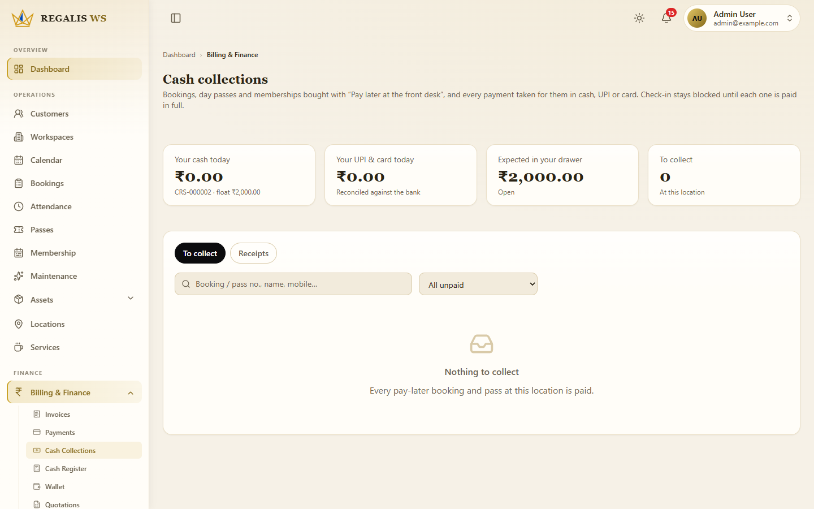

**Header.** "Cash collections", with the subtitle "Bookings, day passes and memberships bought with 'Pay later at the front desk', and every payment taken for them in cash, UPI or card. Check-in stays blocked until each one is paid in full."

**Location.** A location selector appears when there is more than one location. The choice is remembered in the browser.

**Cards** (shown with PAYMENT.CASH_COLLECT)
| Card | Figure |
|---|---|
| Your cash today | Cash receipts in your session; session number and float |
| Your UPI & card today | "Reconciled against the bank" |
| Expected in your drawer | Float + cash received |
| To collect / Receipts | Count |

**"To collect" tab**
- **Filters:** search (booking or pass number, name, mobile); All unpaid / Overdue only.
- **Columns:** Booking / pass (status) | Customer (name, mobile) | What · when | Total | Paid | Due | Due by ("Overdue" when `PaymentDueUtc` has passed) | **Take payment**.
- **Collectable items** [DC CashCollectionService :36-79]:
  - a pay-later booking that is Confirmed, Checked in or Completed, with paid < total;
  - an Active pay-later pass with paid < total.
- **Paging is done in memory** after loading every unpaid row (:134-137).

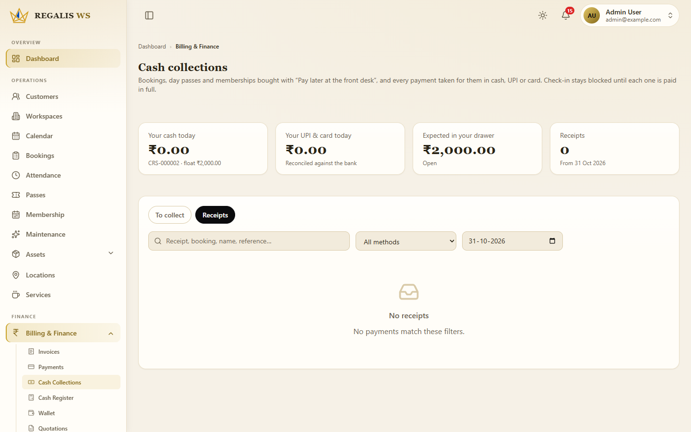

**"Receipts" tab**
- **Filters:** search; Paid by (Cash, UPI, Debit card, Credit card); From (default today IST).
- **Columns:** Receipt (number, time) | Customer · booking (+ invoice) | Received by (+ session) | Paid by (+ reference or change given) | Amount | Status (Recorded / Void with reason) | **Receipt** (PDF) | **Void** (PAYMENT.CASH_VOID).

**Take payment dialog**
- Amount (prefilled with the balance, ≤ balance, 2 decimals).
- Paid by: Cash, UPI, Debit card or Credit card.
- For cash, "Cash handed over" (optional), with change shown.
- For UPI or card, the transaction id or slip number (required, ≤ 50).
- Notes (≤ 500).

On save, in one Serializable transaction [DC CashCollectionService.RecordAsync :140-251]:
1. Opens your register for today, with a 0 float, if none is open.
2. Creates a Success `TRN_Payment` (`PAY-…`) and a `TRN_CashCollection` (receipt `REG/RCPT/2026-27/00001`).
3. Adds the amount to the booking or pass and to its invoice. Paid, part-paid and pending follow 4.3.
4. Notifies the customer and the admins.

The receipt PDF then downloads automatically.

**Void dialog.** Reason is required. The receipt stays, marked void. The amount goes back onto the booking's balance, and the payment becomes Cancelled [:373-434].

### 13.2 Cash Register — `/admin/billing/cash-register`

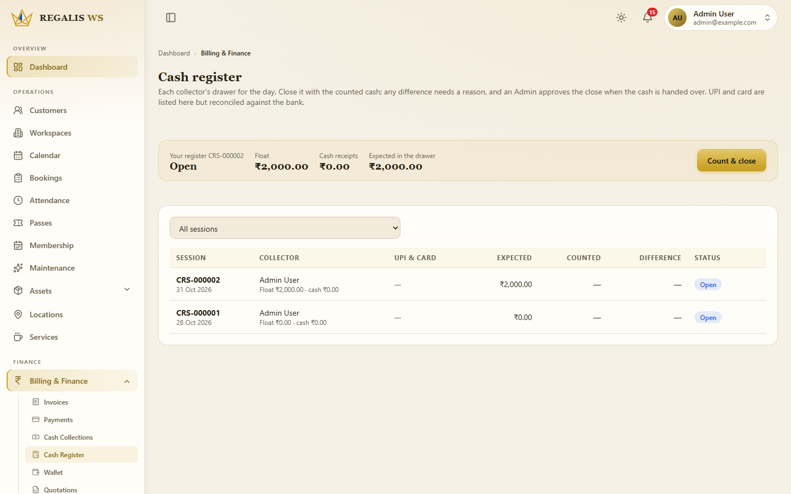

**Header.** "Cash register", with the subtitle "Each collector's drawer for the day. Close it with the counted cash; any difference needs a reason, and an Admin approves the close when the cash is handed over. UPI and card are listed here but reconciled against the bank."

**"Your register" band**
- Shows session number, status, float, cash receipts and expected (while open) or counted (after closing).
- **Count & close** while open, or **Open register** when none exists today.

**Sessions table**
- **Filter:** All / Open / Awaiting approval / Approved.
- **Columns:** Session (number, business date) | Collector (float · cash) | UPI & card | Expected | Counted | Difference (+ reason) | Status (Open; "Closed — awaiting approval"; Approved, by whom).
- **Approve** (PAYMENT.CASH_APPROVE): no confirmation step.

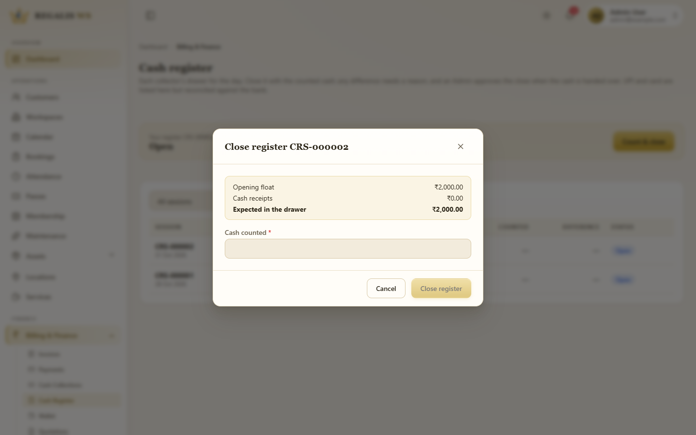

**Rules** [DC CashRegisterService]
- One session per location, user and IST business date (unique index).
- **Open:** float 0 to 1,000,000. Refused if a session already exists today.
- **Close:**
  - allowed for the owner or a CASH_APPROVE holder;
  - expected = float + cash receipts;
  - counted ≠ expected needs a reason;
  - the session becomes **Closed**.
- **Approve:** Closed → **HandedOver** (shown as "Approved").

**Rough edges**
- No reopen exists, so a collector whose register is closed cannot take another payment that day.
- **A receipt can be voided after its session was closed or approved.** The approved figures then silently stop matching.
- **An Admin can approve their own close.**
- The screenshot shows a 28 Oct session still Open next to today's. Sessions are never closed automatically.

### 13.3 Statuses
- **Receipt:** Recorded → Voided.
- **Session:** Open → Closed → HandedOver. There is no way back.

### 13.4 Permissions and endpoints

Permissions are as seeded by `db/migrations/20261027182100_PayLaterAccess.sql:48-52` and present in Dev:
- **CASH_COLLECT and CASH_CLOSE:** Administrator, Operations Manager, Finance.
- **CASH_VOID and CASH_APPROVE:** Administrator only.

Endpoints are on `[Route("api/cash")][StaffOnly]` [DC CashController]:

| Method and path | Permission | Line |
|---|---|---|
| GET `/api/cash/outstanding` (LocationId, OverdueOnly, From, To, paging, Search) | PAYMENT.VIEW | 20 |
| POST `/api/cash/collections` `{bookingId? or customerPassId?, amount, paymentMethod, amountTendered?, reference?, notes?}` | PAYMENT.CASH_COLLECT | 29 |
| GET `/api/cash/collections` (LocationId, CollectedByUserId, BookingId, CustomerPassId, CashRegisterSessionId, PaymentMethod, Status, From, To, paging), `/{id}` | PAYMENT.VIEW | 37, 45 |
| GET `/api/cash/collections/{id}/receipt` → PDF | PAYMENT.VIEW | 54 |
| POST `/api/cash/collections/{id}/void` `{reason}` | PAYMENT.CASH_VOID | 64 |
| GET `/api/cash/register/current?locationId` | PAYMENT.CASH_COLLECT | 73 |
| POST `/api/cash/register/open` `{locationId, openingFloat}` | PAYMENT.CASH_CLOSE | 81 |
| POST `/api/cash/register/{id}/close` `{countedCash, varianceReason?}` | PAYMENT.CASH_CLOSE | 90 |
| POST `/api/cash/register/{id}/approve` | PAYMENT.CASH_APPROVE | 99 |
| GET `/api/cash/register/{id}`, `/api/cash/register` (LocationId, UserId, Status, From, To, paging) | PAYMENT.VIEW | 107, 115 |

**Cash receipt PDF** [DC CashReceiptPdfGenerator]:
- Title "PAYMENT RECEIPT", or "PAYMENT RECEIPT - VOID".
- Received from; receipt number, date and time IST, payment number; booking, workspace, when, invoice; paid by and reference; cash handed over and change.
- Amount received, with the amount in words; booking total, paid so far, balance due.
- "Received by {collector}".
- With production's empty company settings it would print no GSTIN and no address.

### 13.5 Production settings the feature reads, if migrated (`PayLaterAccess.sql:92-108`)

- `PayLater.Enabled` (ships false).
- `PayLater.AllowedBookingKinds`.
- `PayLater.MaxAmount` and `PayLater.MaxOutstandingPerCustomer` (0 = no limit).
- `PayLater.MaxOpenBookings`.
- `PayLater.DueBeforeStartMinutes` and `PayLater.AutoCancelAfterStartMinutes`.
- `PayLater.BlockCheckInUntilPaid` (code fallback true).
- `PayLater.ReminderHoursBefore` and `PayLater.AutoBlockAfterUnpaidNoShows`.
- `PayLater.AllowedPassKinds` (code fallback "DayPass,Membership").
- `Wallet.DeskAddMoneyEnabled`.

---

## Appendix A. How this was produced

1. **Frontend.**
   - Production `index.html`, `env.js` and all 85 JavaScript chunks were fetched from `https://amstagserver.discus-ordinal.ts.net`: GET only, logged out.
   - They were compared with `frontend/assets` after stripping carriage returns. All chunks were identical; only `env.js` differed.
2. **Backend.** `api\Regalis.API / Application / Domain / Infrastructure.dll` were decompiled to C# projects with ilspycmd 11.2. Every [DC] reference points into that output.
3. **Swagger.** The repo's `api\Regalis.API.exe` was run locally on port 81 (Development environment, .NET roll-forward, no migrations, no seeding) and `/swagger/v1/swagger.json` was saved.
4. **Production schema.**
   - Free disk space before restoring was D: 249 GB, C: 61 GB.
   - `RegalisWorkSpace_PROD_20261025_0200.bak` was restored as **`RegalisBilling_SchemaScratch`** on `localhost\SQLEXPRESS2025`.
   - Only these were read: `INFORMATION_SCHEMA`, indexes, constraints, `MST_AppSetting`, `MST_NumberSequence`, `MST_Menu`, `MAP_RoleMenu`, `MST_Permission`, `MAP_RolePermission`, `__EFMigrationsHistory`, and row counts.
   - No customer, company, contact or invoice values from it appear in this document.
   - `RegalisWorkSpace_PROD` was never touched. **The scratch database has been dropped.**
5. **Screenshots** (headless Chrome 1440 × 900, driven over the DevTools protocol by a small Python script).
   - The deployed frontend was served on :8080 with the same `/api` proxy rule as `frontend/web.config`.
   - The API ran against **`RegalisBilling_ScreensScratch`**, a copy of Dev in which every person's name, email, mobile, company, GSTIN, address, supplier name and code, bank account name and number, quotation activity text and the company email were replaced with made-up values.
   - Made-up suppliers, expenses, a bank account, bank lines and two POs were added through the API.
   - Dev already had `PayLaterCash` and `CashInvoiceCollections`. `db/migrations/20261028064444_PayLaterPasses.sql` was applied to the copy only, because without it this build fails against Dev (12.1, point 3).
   - For the access tests, a Housekeeping user and a user moved to Operations Manager were given a known password in that copy only.
   - Every image was then reviewed for leftover real data.
   - **That database has been dropped**, and so has its intermediate backup file.
6. **Sample PDFs** were downloaded from the same local run, and page 1 rendered to PNG.

## Appendix B. Every NOT CONFIRMED in this document

| Item | What I tried |
|---|---|
| Production API is the same build as the repo | Production DLL path (absent here); production swagger (disabled, 401); logged-out probes (401 for all paths); anonymous settings endpoint (cannot distinguish) |
| Cash API endpoints exist in production | Same as above |
| Cash tables and migrations applied in production after 25 Oct | Only the 25 Oct backup is available; no logged-in access; no later backup |
| Production `SeedOnStartup`, SMTP and payment-gateway configuration | These live in the production web.config on the server; only the setup scripts and repo appsettings were readable |
| SQL handling of a third decimal on expense and bank amounts | No validator found; not tested by insert |
| Unique-index 500 errors on reusing deleted codes | Derived from code and index definitions; not executed |
| Quotation attachment links returning 401 | Derived from code; not clicked |
